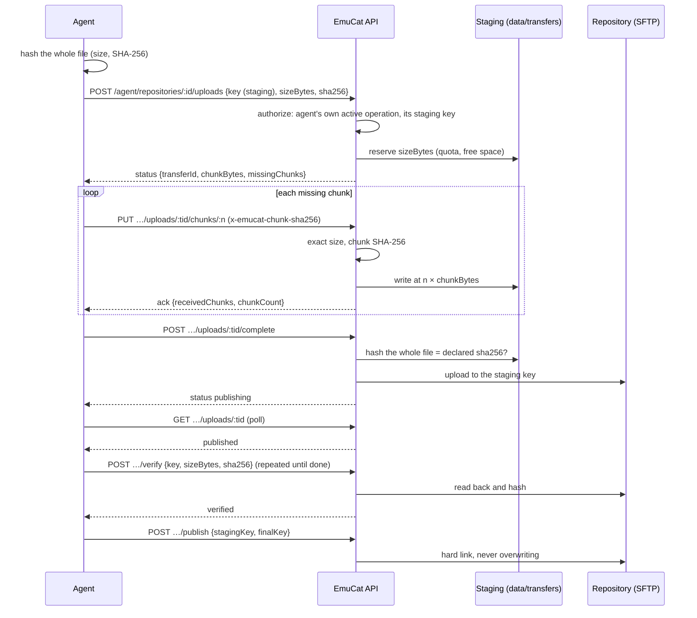
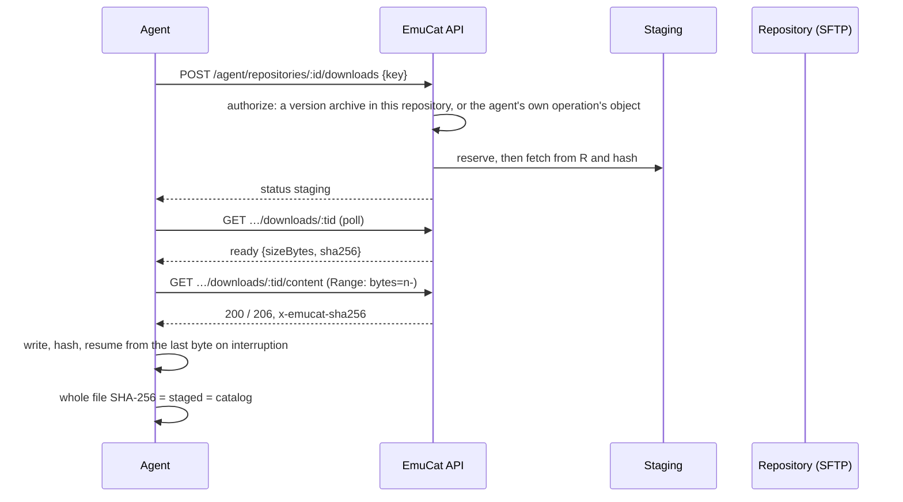

# 0055: The server has its own repository connection; agents fall back to an HTTPS relay; clones are made by the server

**Status:** Accepted. Amends [0012](0012-direct-agent-repository.md) (archives no longer always bypass the server)
and [0052](0052-vm-clones.md) (a clone is no longer made by an agent). Extends [0014](0014-archive-and-manifest.md),
[0015](0015-registration-state-machine.md) and [0049](0049-ova-repository-import.md).

## Context

Until now only agents ever talked to a repository ([0012](0012-direct-agent-repository.md)). That kept archive bytes
off the server, but it had three costs:

- **An agent that cannot reach the repository cannot do anything with it.** A laptop away from home, a PC on another
  VLAN or behind a firewall that allows HTTPS to the EmuCat server but not SSH to the NAS: none of them can register,
  restore or snapshot.
- **A clone needed an online agent** ([0052](0052-vm-clones.md)) to download a whole archive and upload it again,
  although nothing about a clone involves an agent's computer.
- **Nobody could see what an archive holds** without restoring it somewhere.

The server is usually in a better place to reach the repository than any agent (same LAN or VPN as the NAS), and it
already has a persistent disk.

## Decision

### 1. Direct SFTP stays the preferred path; the server relays only when that is impossible

An agent keeps using its own SFTP connection, with its own key and host-key checks, exactly as before. Only when it
**cannot reach the repository at all** does it send or fetch archives through the server:

```
Direct:  Agent ──SFTP──▶ Repository
Relay:   Agent ──HTTPS (agent credential)──▶ EmuCat API ──SFTP (server key)──▶ Repository
                                               │
                                               └─ staging on data/transfers
```

Each agent repository has a `transport` setting: `auto` (default: SFTP, relay on reachability failure), `sftp` (never
the relay) or `relay` (never SFTP; no SFTP settings or key on the agent at all).

**What counts as "cannot reach".** Only `RepositoryErrorKind::Unreachable` on SFTP: a refused or timed-out TCP
connection, DNS failure, or a timeout before the SSH session is up. Never: authentication failure, unknown or changed
host key, permission denied, a full disk, a hash mismatch, a bad configuration or a cancelled operation. Those are
reported as they are, because going around them through the server would hide a real problem (or an attack). When the
relay is not available either, the SFTP error is reported, with the relay's reason appended.

**The choice is made once per opened repository**, by the first operation of a job, and kept for the rest of it: one
registration's upload, verification and publication all go the same way. The agent reports in every health check
which transport it used (`transport: "sftp" | "relay"` in `agent.repository_health_result`), and the Repositories page
shows it.

### 2. The server has its own SSH identity and strict host-key checks

The server connects with a **dedicated key** that is only ever a file on the server: `REPOSITORY_SSH_PRIVATE_KEY_PATH`
(in deployments `EMUCAT_ROOT/config/repository-ssh/id_ed25519`, mounted read-only into the API container), an
optional passphrase file, and an OpenSSH `known_hosts` file that **must** contain the repository's host key. The key
is read when a connection opens, and is never stored in the database, returned by the API, sent to a browser, written
to a log, built into an image or committed. An unknown or changed host key is refused, always; there is no setting to
accept one automatically.

A repository may give the server a different address (`serverHost`, `serverPort`) when the server reaches the same
SSH server differently from the agents (internal DNS name, VPN address). The username, remote root and repository
identity are the same. **Test Server Connection** on the Repositories page checks configuration, name resolution,
TCP, host key, authentication, root access, write, read-back, no-overwrite publication and cleanup, step by step,
with test objects under `archives/.staging/` only, and records the result. It never touches an existing object.

### 3. Staging is on the server's disk, bounded and recoverable

Relayed bytes and server-side clones are staged under `TRANSFER_STAGING_PATH` (`data/transfers`), one directory per
transfer or clone, named by a random UUID only. Nothing in a path comes from a request. Staging is bounded by
`TRANSFER_MAX_STAGING_BYTES` (reserved up front for the whole object) and `TRANSFER_MIN_FREE_BYTES` (checked with
`statfs` before each reservation), and `TRANSFER_MAX_CONCURRENT` transfers run at once; a refusal is a clear,
retryable `transfer_staging_full` or `transfer_busy`.

Every transfer is a row in `repository_transfers`; received chunks are rows in `repository_transfer_chunks`. On start
the server adopts the directories its rows still need, removes any other directory, resumes uploads that were being
published and downloads that were being staged, and a sweeper discards transfers idle longer than
`TRANSFER_INACTIVITY_TIMEOUT_SECONDS` and finished ones after `TRANSFER_RETENTION_SECONDS`. Bytes never outlive
their row.

### 4. Uploads are resumable chunks with end-to-end hashes



- Every chunk but the last is exactly `chunkBytes` (`TRANSFER_CHUNK_BYTES`, 8 MiB by default, between 256 KiB and
  64 MiB), and carries its SHA-256. A chunk that arrives twice with the same hash is acknowledged again; with a
  different hash it is refused (`chunk_conflict`).
- Repeating the init request with the same key, size and hash **resumes** the same transfer: the status lists the
  missing chunks as ranges. Anything else at that key replaces an unfinished upload of it.
- `complete` is idempotent. The whole file's SHA-256 is checked on the server before anything reaches the repository,
  and the repository object is then verified from the repository itself, exactly as over SFTP.
- The relay only ever **writes** `archives/.staging/<operation>.part` of the agent's own active operation, and only
  **publishes** that to that operation's own final key. It cannot overwrite: publication is the same hard link as
  the agent's ([0012](0012-direct-agent-repository.md)).

### 5. Downloads are staged once, verified, and read with `Range`



The server checks a catalog version's archive against its registered SHA-256 before offering it. Two agents asking
for the same object share one staged copy. The agent resumes an interrupted read with `Range: bytes=<offset>-`, and
compares the whole file's hash with what the server staged; the restore then checks it against the catalog as
always.

### 6. Authorization

Every relay route needs the agent's bearer credential (the same as for its WebSocket) and is checked against the
agent's own operations and the catalog by `RelayAuthorization`: the agent must be associated with the repository and
not revoked, and the repository enabled. There is no route that lists a repository, no unauthenticated download, no
way to name a server path, and no browser access. Uploads must name a staging key; reads must name a version archive
of that repository or an object of the agent's own operation; deletes only the agent's own staging object, its own
uncommitted operation's archive, or an archive being deleted under its own deletion operation.

### 7. Clones are made by the server

A clone ([0052](0052-vm-clones.md)) is still a registration operation of the new VM, with the same reservation,
states, idempotency and commit. Since this decision it names **no agent** (`agent_id` NULL, `performedBy: "server"`),
and the server does every step itself: validate the source and destination, download the source archive to staging,
check it against the catalog, write the clone (for a ZIP, a new archive whose manifest names the new VM, with every
file's bytes and SHA-256 checked again; for an OVA, the same bytes), verify it, upload it to the repository's staging
key, verify it there, publish it under the new version's key, and commit. No agent has to be online, and no agent's
disk is touched. A server restart resumes a clone (bounded by three attempts), and a cancelled or failed clone
removes what it staged and published. Requests from browsers of the previous release that still send `agentId` are
accepted and the field is ignored.

### 8. Archive inspection

**View Archive Contents** in Version History shows what a version's archive holds, read by the server over its own
connection, without downloading, extracting or changing it:

- **VM files** (logical view, ZIPs): the files as the version restores them, from the archive's manifest, with sizes
  and SHA-256, and whether the manifest is the one verified at registration.
- **Stored entries** (physical view, ZIP and OVA): the entries in the archive file itself, with stored size and
  method.

The server reads only the ZIP's central directory and manifest (or the OVA's tar headers), with the same rules the
agent applies to archives (no traversal, no links, no duplicates differing by case, no encrypted entries) and bounded
sizes (500,000 entries, 128 MiB of central directory or manifest). Listings are one directory at a time, paged, with
a path search. At most two archives are read at once, and the last eight are cached for ten minutes. Only
administrators may use it.

## Consequences

- An agent without a route to the repository can still register, restore, snapshot and remaster, through the server.
  The server needs disk space for what it relays and clones, and the reverse proxies must allow requests of one
  chunk (8 MiB by default).
- The server holds a credential for the repository. It is a separate key, revocable on its own in `authorized_keys`,
  confined to the same restricted account the agents use ([repositories.md](../repositories.md)).
- Older agents keep working: they never use the relay and never send `transport`. Older servers answer the relay
  routes with 404, which a new agent treats as "no relay", and reports the SFTP error.
- Migration `0021` is additive: a nullable `registration_operations.agent_id` (only for clones), the transfer
  tables, the last Test Server Connection per repository, and `agent_repositories.last_transport`.
