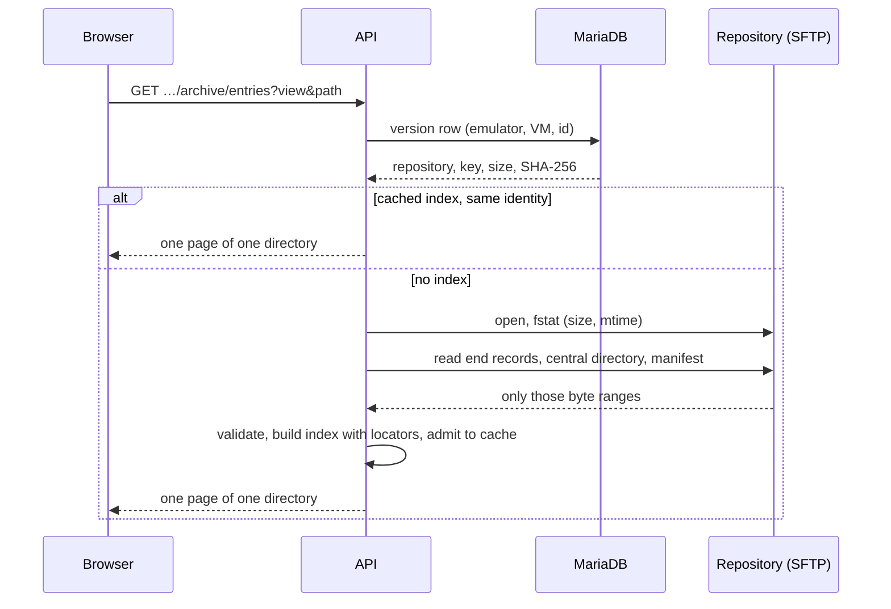
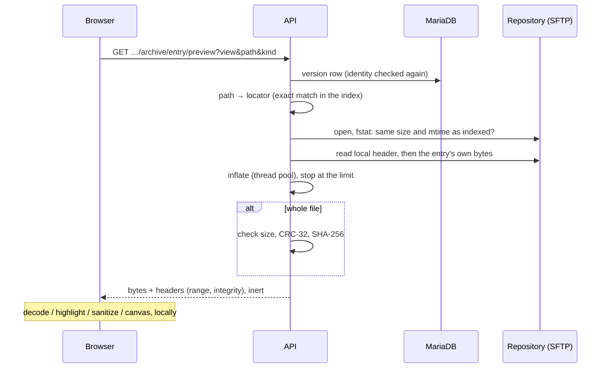
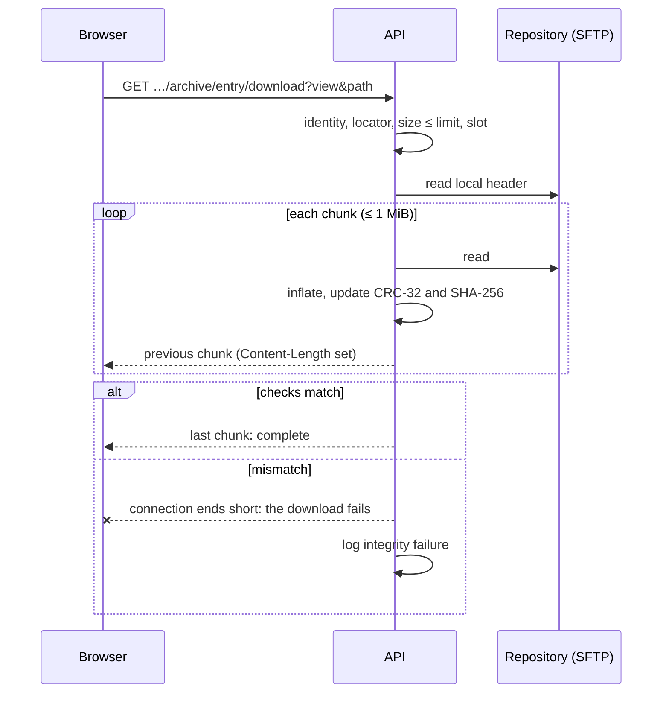

# 0056: Archive Explorer reads one file of an archive through the server, diskless and read-only

**Status:** Accepted. Extends [0055](0055-server-repository-access.md) (View Archive Contents), [0014](0014-archive-and-manifest.md)
(archive and manifest) and [0025](0025-bounded-image-decoders.md) (bounded image decoders).

## Context

View Archive Contents ([0055](0055-server-repository-access.md)) lists what a version's archive holds by reading its
structure over the server's own SFTP connection. Administrators also want to look at individual files of an archive
(a configuration file, a README, a screenshot, a manual, a ROM's header) and to fetch one of them, without restoring
the version on an agent and without the server downloading the archive.

An assessment of the inspection code at `a2e8988` found that it already read only what it needed, wrote nothing to
disk and used no staging, and also listed corrections, kept here as R1–R10: a coalesced request skipped the identity
check (R1), nothing was cancellable or bounded in time end to end (R2), the index cache was bounded by count but not by
memory (R3), manifest inflation was synchronous (R4), limits were not configurable (R5), two error codes had no text
(R6), staging sweep failures were silent (R7), unexpected staging files went unreported (R8), previews must not need
weaker framing rules (R9), and a cached index could in principle be used against a replaced object (R10).

## Decision

### 1. One modal, two panels, read-only

**View contents…** in Version History, for masters and snapshots alike, opens **Archive Explorer**: a tree of the
archive's directories on the left, listed lazily one directory and one page (200 entries) at a time, and the selected
file's details and preview on the right. The logical view (the VM's files, from the manifest) and the physical view
(entries stored in the archive file) are kept; an OVA has the physical view only. Search lists matching paths. Below
768 px one panel shows at a time.

These are the files **of the archive**. A virtual disk image is a file like any other here: its bytes can be shown
in hex, but its guest filesystem (FAT, NTFS, ext, QCOW2, VDI, VHD contents) is not explored, nor are nested archives.

Nothing changes anywhere: no archive, manifest, repository object, version or registration is modified, and no agent
is involved.

### 2. Selective remote extraction with server-side locators

When the server indexes an archive it keeps, for every file, a compact **locator**:

- ZIP and ZIP64: the stored name, local header offset, compressed and uncompressed sizes, method, CRC-32, flags, and
  the offset of the central directory (no entry's data may reach it).
- TAR (OVA): the data offset and size of a regular file. Links, devices, directories and anything but regular files
  are refused when the archive is indexed, as an agent's restore refuses them. How the archive may end, with or
  without an end marker, is the agent's import policy ([0057](0057-ova-tar-compatibility.md)).

Locators never leave the server. A request names a version, a view and a path **exactly** as a listing returned it;
the path is looked up in the index (binary search, exact match, no normalization), never used as a file name, and
offsets, sizes or methods are never taken from a request.

To read a file the server opens the archive over SFTP and checks the locator again against the bytes: the local
header must have the right signature, name, method and, without a data descriptor, the same CRC and sizes; the data
must end before the central directory and inside the object; a deflate claim beyond about 1032:1 is refused before
anything is inflated; inflation stops at the recorded size. Stored entries and TAR files are read at any offset
directly; a deflated entry can only be read from its start, and a hex view may start at most
`ARCHIVE_PREVIEW_SEEK_BYTES` into it, since everything before has to be inflated. Encrypted entries and methods other
than stored and deflate are refused.

Reads go through the existing `RepositoryAccess` → `RepositorySession` → `ObjectReader` abstraction, whose `read`
now takes an `AbortSignal` and whose reader reports the object's modification time. There is no second SFTP
implementation, and host-key verification and the server's key handling are unchanged.

### 3. Diskless

Nothing in Archive Explorer writes a file. Bytes are read in chunks of at most 1 MiB (16 SFTP requests of 64 KiB in
flight), inflated by zlib's streaming inflater on the thread pool, and either kept in memory up to a preview's limit
or streamed to the browser. The transfer staging area (`data/transfers`) is not used; neither is `/tmp`, the
container's writable layer or any cache on disk. Extracted contents are never cached, in memory or anywhere.

### 4. Previews

One endpoint returns a file's details: its metadata, what it is, and which preview modes fit. **What a file is comes
from its bytes**: image signatures, `%PDF-`, byte-order marks and a text heuristic. Its name is used only for what has
no signature: the highlighting language, Markdown, and the PCX and TGA formats, whose headers must also be valid.

| Kind     | How it is shown                                                                                                                                                                                                                                                        |
| -------- | ---------------------------------------------------------------------------------------------------------------------------------------------------------------------------------------------------------------------------------------------------------------------- |
| Text     | The first `ARCHIVE_PREVIEW_TEXT_BYTES` as bytes; the browser decodes them (UTF-8, UTF-16 LE/BE, Windows-1252, CP437, CP850), so changing the encoding needs no request. Word wrap, copy, and highlighting with the highlight.js build Vditor already ships and serves. |
| Markdown | Rendered by Lute (Vditor's `md2html`) and sanitized by a dedicated, stricter DOMPurify instance; the source is the Text mode, from the same bytes.                                                                                                                     |
| Images   | PNG, JPEG, GIF, WebP, BMP and ICO pass through unchanged after a header check of their dimensions; PPM (P3, P6), TIFF (first page), PCX and TGA are decoded and re-encoded as PNG in memory.                                                                           |
| PDF      | PDF.js, loaded only when a PDF is opened, drawing pages on a canvas.                                                                                                                                                                                                   |
| Hex      | `ARCHIVE_PREVIEW_HEX_BYTES` from any offset, 16 bytes a row with offsets, hex and ASCII or CP437 characters.                                                                                                                                                           |
| Other    | Its details, the hex view and the download.                                                                                                                                                                                                                            |

Encoding detection is deterministic first (byte-order mark, UTF-16 by its zeros, strict UTF-8) and only then a
heuristic between Windows-1252 and CP437, which the interface calls a guess. CP850 is offered, never guessed.

PCX (RLE, 8-bit with palette, 24-bit, monochrome, 16-colour EGA) and TGA (types 1, 2, 3, 9, 10, 11; 8, 15, 16, 24, 32
bits) are decoded by two small decoders written for EmuCat in the style of [0025](0025-bounded-image-decoders.md):
dimensions are checked before anything is allocated, input is never read past its end, and they yield so that a
deadline can stop them. Other variants are refused, not guessed at.

### 5. Downloads

A file of at most `ARCHIVE_DOWNLOAD_MAX_BYTES` can be downloaded on its own. It is streamed from the repository to
the browser through memory, with `Content-Length` set, `Content-Disposition: attachment` and a sanitized name (ASCII
`filename`, UTF-8 `filename*`, no control characters, quotes, separators or semicolons), never through staging.
Larger files are refused (413 `download_too_large`); the interface says so and suggests restoring the version.

### 6. Integrity

- **A complete preview** (a whole file in memory: text that fits, images, PDFs) is checked before it is returned: its
  size, its CRC-32 (ZIP) and, when the manifest has one and is the registered manifest, its SHA-256. A mismatch is an
  error (`integrity_failed`), never data. The response says `verified` (CRC and, where known, SHA-256 matched) or
  `complete` (a TAR file: the format records no checksum).
- **A partial preview** (a text prefix, a hex window) says `partial`: its local header and structure were checked,
  and no checksum covers part of a file. The interface says so.
- **A download** is checked while it streams. The server holds back its last chunk until the whole file has matched;
  with `Content-Length` set, a file that fails can never arrive complete: the response is cut short, the browser's
  download fails, and the server logs it. The interface keeps the bytes in memory and saves them only once the whole
  file has arrived.
- The archive's own SHA-256 is not recomputed: that would mean reading the whole archive. It was verified when the
  version was registered, and Verify still checks it.

### 7. Identity and the cache (R1, R10)

Every request reads the version's row again, scoped by emulator, VM and version id, and fails with
`version_not_found` or `version_deleted` before anything cached is used, whether the index is cached, being built
for another request, or built now. A cached index is used only while the row still names the same repository,
archive key, size and SHA-256. Before any file is read, the object's size and modification time in the repository are
compared with those seen when the index was built; archives are immutable once published, so any difference means the
object was replaced: the index is dropped and the request fails with `archive_changed`.

The index cache keeps at most `ARCHIVE_CACHE_MAX_INDEXES` indexes for `ARCHIVE_CACHE_TTL_SECONDS`, least recently used
first out, within `ARCHIVE_CACHE_MAX_BYTES`, an **estimate** of their weight (a fixed cost per entry plus two bytes a
character of its strings), not a measurement of the process. An index larger than the whole budget is used for its
request and not kept.

### 8. Cancellation and deadlines (R2)

Requests for the same version share one index load. Each requester joins with its own signal and can leave on its
own; the load is aborted only when every requester has left, or at `ARCHIVE_INSPECTION_TIMEOUT_SECONDS`. Every
preview has its own deadline (`ARCHIVE_PREVIEW_TIMEOUT_SECONDS`), every download too
(`ARCHIVE_DOWNLOAD_TIMEOUT_SECONDS`), and each is aborted when the browser goes away. Aborting closes the SSH
connection at once, which ends every SFTP request in flight; SFTP requests are still individually bounded by
`REPOSITORY_SSH_REQUEST_TIMEOUT_SECONDS`. Every repository connection is closed in a `finally`, whatever happens.

In the browser, each selected file's panel aborts its requests when another file is selected or the dialog closes,
and nothing that answers late can replace a newer file.

### 9. Resource limits (R3, R5)

| Variable                                 | Default           | What it bounds                                              |
| ---------------------------------------- | ----------------- | ----------------------------------------------------------- |
| `ARCHIVE_INSPECTION_MAX_ENTRIES`         | 200 000           | Entries of an archive the server indexes                    |
| `ARCHIVE_INSPECTION_MAX_DIRECTORY_BYTES` | 64 MiB            | A ZIP central directory read into memory                    |
| `ARCHIVE_INSPECTION_MAX_MANIFEST_BYTES`  | 64 MiB            | The manifest inflated and parsed                            |
| `ARCHIVE_INSPECTION_MAX_CONCURRENT`      | 2                 | Indexes built at once                                       |
| `ARCHIVE_INSPECTION_TIMEOUT_SECONDS`     | 120               | Building one index                                          |
| `ARCHIVE_CACHE_MAX_INDEXES`              | 8                 | Indexes kept                                                |
| `ARCHIVE_CACHE_TTL_SECONDS`              | 600               | How long one is kept                                        |
| `ARCHIVE_CACHE_MAX_BYTES`                | 64 MiB            | Estimated weight of the indexes kept                        |
| `ARCHIVE_PREVIEW_TEXT_BYTES`             | 256 KiB           | Text shown                                                  |
| `ARCHIVE_PREVIEW_HEX_BYTES`              | 64 KiB            | One hex window                                              |
| `ARCHIVE_PREVIEW_IMAGE_BYTES`            | 20 MiB            | An image file previewed                                     |
| `ARCHIVE_PREVIEW_IMAGE_PIXELS`           | 16 777 216        | Pixels of an image previewed (decoded in memory for legacy) |
| `ARCHIVE_PREVIEW_PDF_BYTES`              | 25 MiB            | A PDF previewed                                             |
| `ARCHIVE_PREVIEW_SEEK_BYTES`             | 16 MiB            | How far into a deflated entry a hex window may start        |
| `ARCHIVE_PREVIEW_MAX_CONCURRENT`         | 2                 | Previews and details at once                                |
| `ARCHIVE_PREVIEW_MAX_QUEUED`             | 8                 | Previews that may wait up to 10 s for a slot                |
| `ARCHIVE_PREVIEW_TIMEOUT_SECONDS`        | 60                | One preview                                                 |
| `ARCHIVE_DOWNLOAD_MAX_BYTES`             | 100 MiB (0 = off) | One file downloaded                                         |
| `ARCHIVE_DOWNLOAD_MAX_CONCURRENT`        | 2                 | Downloads at once                                           |
| `ARCHIVE_DOWNLOAD_MAX_QUEUED`            | 2                 | Downloads that may wait up to 10 s for a slot               |
| `ARCHIVE_DOWNLOAD_TIMEOUT_SECONDS`       | 1800              | One download                                                |

The defaults are sized for the API container's 1 GiB limit beside transfers, clones and screenshot processing. The
largest preview cost is an image conversion: its input (20 MiB), decoded pixels (16.7 megapixels × 4 bytes, 64 MiB)
and PNG, so two at once stay near 200 MiB. 16.7 rather than the suggested 25 megapixels keeps that worst case below a
fifth of the container. The inspection entry limit is 200 000 rather than the agent's 500 000: an index of that many
entries is estimated at about 150 MiB transiently and would not fit the cache anyway. A slot that is taken makes a
request wait briefly in a short queue (a person clicking through files makes bursts), and refuses it with
`preview_busy` or `download_busy` beyond that.

### 10. Event loop (R4)

Manifest inflation now runs on zlib's thread pool. Preview inflation streams on the thread pool. Image conversion runs
in libvips (sharp) with its own timeout; the PPM, PCX and TGA decoders yield between slices under a deadline. What
remains synchronous: parsing the central directory (bounded by `ARCHIVE_INSPECTION_MAX_DIRECTORY_BYTES`), parsing and
re-serializing the manifest to check that it is canonical (bounded by `ARCHIVE_INSPECTION_MAX_MANIFEST_BYTES`), and
building the index (bounded by `ARCHIVE_INSPECTION_MAX_ENTRIES`). Moving those to a worker thread would need the
index to cross threads; with these bounds it is not worth it now.

### 11. Browser safety (R9)

Archive contents are never served as a page or a script under the application's origin. Every preview and download
response is `Cache-Control: no-store`, `X-Content-Type-Options: nosniff`, `Content-Security-Policy: default-src 'none';
sandbox`, `Cross-Origin-Resource-Policy: same-origin`, `X-Frame-Options: DENY` and `Content-Disposition: attachment`;
only images have an image type, and a PDF is `application/octet-stream`, so opening one directly starts no viewer.
The routes refuse requests whose `Sec-Fetch-Site` is another site, even plain GETs.

The application fetches the bytes and renders them itself: text as text nodes (or highlighted `span`s, sanitized),
HTML, XML and SVG as source, images from local `blob:` URLs released when they are no longer shown, PDFs on a canvas.
The Markdown sanitizer keeps text formatting only: no images (replaced by a note), media, frames, forms, styles,
scripts, SVG, MathML, `id` or `name`; links keep their text and show their target, but do not navigate. Nothing a file
contains can make the browser request anything.

PDF.js runs with its worker and every data file (CMaps, standard fonts, ICC profile, JBIG2 and JPEG 2000 decoders)
from `/vendor/pdfjs/<version>/` on this origin. Its QuickJS scripting engine is not published, no annotation or text
layer is mounted (so links, forms and actions in a PDF are inert), XFA is off, and the document is destroyed with its
worker when the file changes or the dialog closes. The worker is emitted as `.js`, since the web container's nginx
maps only `.js` to JavaScript.

No global header changed: nginx keeps `X-Frame-Options: DENY` everywhere, and nothing is framed.

### 12. Authorization

Every request of Archive Explorer, listing, details, preview and download alike, runs the session, administrator and
same-origin checks itself and the identity check of section 7. Nothing is public, and nothing relies on an earlier
listing.

### 13. Staging diagnostics (R7, R8)

A periodic staging sweep that fails is logged at warning level with the operation, the staging root and the number of
consecutive failures: the first at once, then at most every 15 minutes, and a recovery once. Files or directories in
`transfers/` or `clones/` that are not UUID-named are reported at start and after each sweep (again only when what is
there changes) and are never deleted: only names the server issued are ever removed.

## Consequences

- Administrators can read and fetch an archive's files without an agent, and the server never holds more than a
  preview's bytes or a stream's chunks of any of them.
- Every preview opens a short SSH connection of its own. That keeps the lifetime of connections obvious and their
  release certain, at the cost of a handshake per file.
- A deflated entry cannot be browsed in hex beyond its first 16 MiB; stored entries and OVAs can, at any offset.
- Integrity of a streamed download is proven only at its end; until then the browser holds the bytes and does not
  save them.
- `pdfjs-dist` (Apache-2.0) is a new dependency of the web application, lazy-loaded; highlight.js and Lute are reused
  from Vditor, sharp from the API. There is no new dependency on the server.

## Diagrams

### Listing

### Preview

### Download

