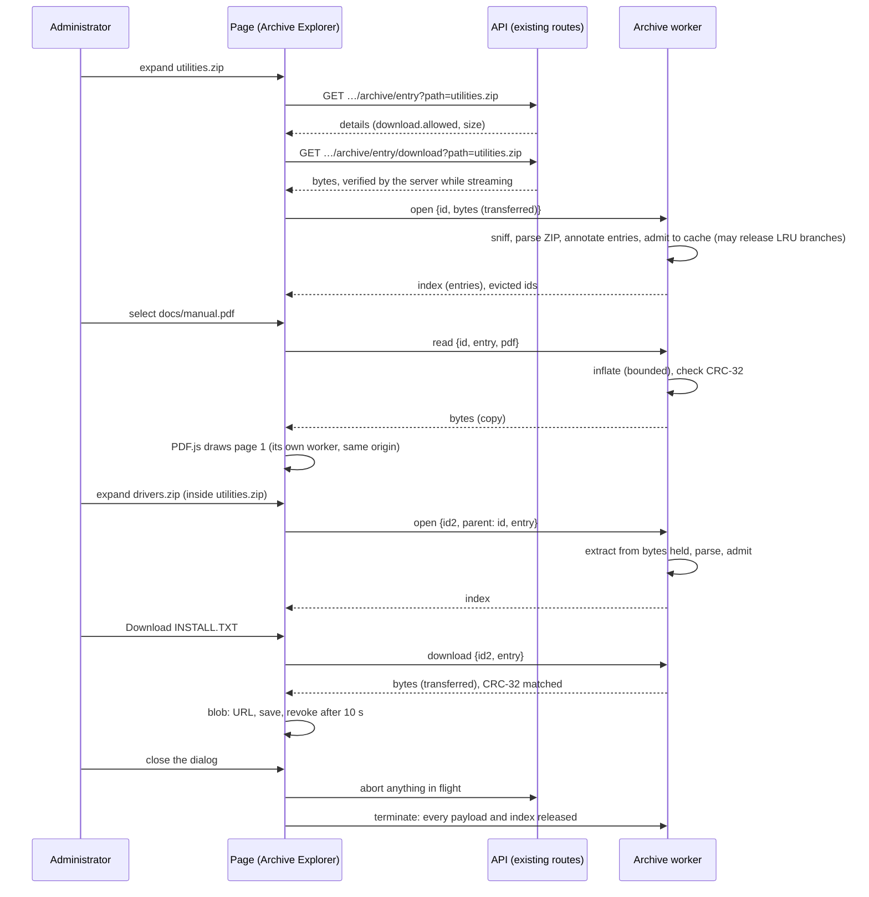

# 0058: Archive Explorer opens archives inside archives in the browser, and shows files in a compact viewer

**Status:** Accepted. Extends [0056](0056-archive-explorer.md) (Archive Explorer) and applies
[0057](0057-ova-tar-compatibility.md) (TAR endings) in the browser. No API, contract, agent, schema or deployment
change.

## Context

Archive Explorer (0056) lists a version's archive and previews or downloads one of its files through the server. Two
things were missing.

- **Space.** The file panel showed metadata, the download button, the preview mode buttons and each viewer's settings
  stacked above the content: on a 1280 × 800 window a text file started about 60% of the way down the dialog.
- **Archives inside archives.** 86Box and QEMU VMs often carry `utilities.zip`, `drivers.tar.gz` or an OVA among
  their files. 0056 showed them as files only: hex and download.

The server already extracts one file of a version's archive selectively, verifies it and streams it to the browser
(0056 §5). Teaching the server to open nested archives would mean new endpoints, new server-side parsers and new
server memory. This milestone was required to stay in the frontend.

## Decision

### 1. A compact viewer, built from reusable icon primitives

`lucide-react` (ISC, imported icon by icon, so unused icons are not bundled) is the icon library of the web
application. Archive Explorer is the first area to use it. The primitives live in `apps/web/src/components/ui/`:
`IconButton`, `IconToggleButton` (`aria-pressed`), `Toolbar` (WAI-ARIA toolbar: Left/Right/Home/End), `ToolbarGroup`,
`ToolbarSeparator`, `ToolbarSpacer`, `InfoPopover` (a non-modal dialog over the content) and `FileTypeIcon`
(`fileIconKind` decides the icon from the name, refined by what the bytes turned out to be). Every icon button has an
`aria-label`; its tooltip repeats it visually and is hidden from assistive technology. The minimum target is 32 px,
44 px on coarse pointers. Colours are Bootstrap's variables, so light and dark themes need nothing specific.

The dialog is a header (title, one identity line, archive **Info**, **Close**), the **VM files / Stored entries**
switch (kept as words: icons would not explain it), and the split. The file panel is a header (type icon, name,
breadcrumb), **one** contextual toolbar (preview modes, then the current viewer's own controls, then **Browse this
archive**, **Download**, file **Info**), the preview filling the remaining height, and a status bar (encoding, image
size, page, byte range, integrity, warnings). Viewers keep their state and put their controls and status into the
toolbar and status bar through portals (`archive-explorer/chrome.tsx`). Metadata is never above the preview: it is in
the Info popovers, which say what each value rests on (declared by the archive, verified by reading the file, from
the EmuCat manifest). Integrity failures stay visible as errors in the preview, never only in Info.

### 2. Nested archives are tree nodes, opened in the browser

A file whose name says ZIP, JAR, TAR, OVA, GZIP or TAR.GZ (never a disk image, whatever its bytes) is an expandable
node with an archive icon. Selecting it shows it as a file (hex, download, **Browse this archive**). Expanding it:

1. checks its size against the browser's limit and the server's single-file download limit, before any transfer;
2. downloads that one file, whole, through the **existing** single-file download (`GET …/archive/entry/download`),
   which the server verifies as it streams (0056 §6);
3. hands the bytes to the archive worker, which confirms the format from the bytes and parses it.

Everything deeper is read from bytes the worker already holds: an archive inside a nested archive is extracted by
the worker, never requested from the server. Nothing read in the browser is ever sent back. The outer master or
snapshot is never downloaded.

### 3. Formats

Implemented with EmuCat's own ZIP and TAR readers in TypeScript and `fflate` (MIT, pure JavaScript, no WebAssembly)
for deflate:

| Format            | Read                                                                                                     |
| ----------------- | -------------------------------------------------------------------------------------------------------- |
| ZIP, JAR          | Central directory; stored and deflated entries; CP437 names without the UTF-8 flag                       |
| ZIP64             | End records, locator and per-entry fields                                                                |
| TAR, OVA          | 0057's endings: zero blocks, or none at an exact entry boundary; ustar, GNU long names, PAX path/size    |
| GZIP, TAR.GZ, TGZ | One member; the trailer's size checked before decompressing, its CRC-32 after; TAR detected by its bytes |

Recognized and **not** opened (the node is a file; the reason is shown): 7z, RAR, BZIP2, XZ, Zstandard, CAB, ARJ, LHA,
compress, other legacy archivers; ZIP methods other than stored and deflate (Deflate64, BZIP2, LZMA, PPMd, Implode…);
encrypted entries; multi-volume archives; self-extracting executables. The only maintained library that reads 7z,
RAR, CAB, ARJ and LHA in a browser is `libarchive.js` (WebAssembly, about 1 MiB). It extracts whole entries into memory
before any limit can apply, and it also opens ISO and other disk images. That failed both the bounded-decompression
and the no-filesystem requirements. `@zip.js/zip.js` was considered for ZIP and brought nothing over 200 lines of
EmuCat's own code that mirrors the server's checks; `JSZip` cannot bound output while inflating.

**Not explored, whatever a library could do:** ISO, raw disk images, VHD/VHDX, VDI, VMDK, QCOW/QCOW2, CHD, FAT, NTFS,
ext. These are guest filesystems. Exploring one is a separate decision.

### 4. What is trusted

A format is decided from the bytes and then by the parser, never from the name alone. A stored or TAR entry is
sniffed while indexing (its bytes are at hand), so an extensionless or misnamed archive is offered too. A compressed
entry is offered by its name and confirmed when opened. Nothing is downloaded just to find out what it is.

Entries are identified by their position in their archive, never by path. Duplicate paths stay separate rows, read
separately. Row identities are structured (`R␀path`, `L␀archive␀#index`, `L␀archive␀/dir`). An entry whose name is
absolute, has `..`, a drive letter or control characters is listed whole at the archive's root, marked, and never
read. Symbolic and hard links, devices, FIFOs and reparse points are listed and never read or followed.

### 5. Limits (`apps/web/src/archive-local/limits.ts`)

| Limit                     | Value                   | Why                                                                                    |
| ------------------------- | ----------------------- | -------------------------------------------------------------------------------------- |
| Nested archive payload    | 64 MiB                  | Below the suggested 100 MiB: a download is briefly held twice (Blob, then ArrayBuffer) |
| Nesting depth             | 5                       | The first archive opened from the version is level 1                                   |
| Retained cache (estimate) | 128 MiB                 | Payloads owned plus about 160 bytes and 2 per path character per entry                 |
| Entries per archive       | 20 000                  |                                                                                        |
| Opens at once / waiting   | 2 / 4                   | More are refused at once (`busy`)                                                      |
| Text, hex window, seek    | 256 KiB, 64 KiB, 16 MiB | As the server (0056)                                                                   |
| Image, pixels, PDF        | 20 MiB, 16.7 MP, 25 MiB | As the server                                                                          |
| Download of an inner file | 100 MiB                 | Decompressed output, enforced while inflating                                          |
| Path                      | 4096 bytes              |                                                                                        |
| One index or read         | 60 s                    | Cooperative deadline in the worker                                                     |

A top-level nested archive can never exceed the server's `ARCHIVE_DOWNLOAD_MAX_BYTES` either: the server's own
answer (`download.allowed`) is checked first.

Decompression never trusts a declared size. Input is pushed 4 KiB at a time, so a single step produces at most a
few MiB, and output goes into a buffer sized for what is wanted, never grown. A whole read stops with an error as
soon as the stream produces more than the entry declares, and the declared size itself must be within the limit. A
prefix (text, hex) stops once it has what it needs. Recursive bombs stop at the depth limit and at the cache budget.

### 6. Memory and the cache

The worker owns every payload. A stored nested archive is a view into its parent and costs nothing more. A deflated
one, or a GZIP's decompressed contents, is a copy and costs its size. Before an archive is kept, the least recently
used archives are released, each with every archive opened inside it, until the new one fits. The archives the shown
file is in, and the new archive's own ancestors, are never released. If that is not enough, the new archive is
refused (`memory_budget`). A released branch collapses in the tree and says so; expanding it again reloads it.

The budget is of what is **kept**. It does not cover a whole tab: an operation also holds transient buffers (the
download's Blob and its ArrayBuffer, an extracted file on its way to a preview or a save, decoded pixels, PDF.js's
copy), and PDF.js's own worker has its own memory. Nothing is ever stored in IndexedDB, localStorage, sessionStorage,
OPFS, Cache Storage or a service worker. A saved file is an ordinary browser download from a `blob:` URL revoked ten
seconds later.

### 7. The worker, cancellation and cleanup

There is one module worker per open Archive Explorer, started on first use. It is bundled by Vite as
`assets/archive.worker-<hash>.js` (a `.js`, which nginx serves as JavaScript, unlike the `.mjs` of 0056's PDF.js
incident). It imports only the contracts' byte-level helpers, through a build alias, so zod is not bundled into it:
about 41 kB. Requests and answers carry an operation id. An aborted request is answered at once (`AbortError`) and
the worker is told to stop: it checks between 4 KiB slices of decompression and between rows of an image, and yields
to its event loop every few milliseconds so a cancel can arrive. A late answer is dropped. An open that finishes
after its cancel is released at once. Closing the dialog aborts the API download in flight and terminates the
worker, which frees everything it held. A worker failure fails every pending request, collapses the branches it held,
and the next request starts a new worker. Collapsing an archive that is still opening cancels it; collapsing one
that is open keeps it, for instant re-expansion.

### 8. Previews of nested files

The existing viewers are used through a `FileSource` adapter (`archive-explorer/source.ts`), which yields the server's
own shapes for both origins. Content detection is the contracts' `detectContent`, shared with the server. Text
(every encoding, highlighting, wrap, copy), Markdown (the same sanitizer; nothing loads or runs), hex, PDF (the same
PDF.js setup, from bytes) and PNG/JPEG/GIF/WebP/BMP/ICO (dimensions read from the header and checked before the
browser decodes) work as for a top-level file. PPM, PCX and TGA are decoded by browser ports of the server's own
bounded decoders, then drawn to a canvas as PNG. **TIFF** inside a nested archive is shown as bytes only: the server
converts it with libvips, and no small, maintained, bounded browser decoder was worth adding.

### 9. Integrity

- The nested archive downloaded from the version is verified by the server as it streams (CRC-32 and, where the
  manifest has one, SHA-256).
- An inner ZIP or GZIP entry read whole is checked against the CRC-32 its archive records. The interface says this
  detects damage, not tampering: a nested archive's checksums prove nothing about who made it.
- A TAR entry is `complete`, never `verified`: TAR records no checksum. A partial read (text prefix, hex window) is
  never called verified.
- The EmuCat manifest's SHA-256 belongs to the outer file only. An inner file never shows it as its own.

### 10. Search

Search keeps the server's search of the version's archive, which never opens anything. Once at least one archive is
open, **Search in** offers **Opened archives**, a search of the indexes already in the browser. It says that archives
not opened were not searched, and it never opens or downloads anything.

## Consequences

- Opening a nested archive transfers that archive's **whole** payload once, unlike a top-level file's preview, which
  reads only what it shows. Everything inside it is then free of network cost.
- The web bundle grows by about 45 kB (16 kB gzipped) for the new interface and icons. The worker (41 kB) loads only
  when a nested archive is opened.
- No server code, endpoint, contract, configuration, migration, nginx rule or agent changed. Server-side limits apply
  unchanged to the one download that starts it all.
- New formats (7z, RAR, …) or guest filesystems need a library that can bound its output, or a server-side design.
  Either is a new decision.

## Sequence

Archive browsing is about files stored in archive formats. Guest filesystem exploration (what is inside `disk.img`,
`hdd.vhd`, a CD image) reads a filesystem inside a block device: a different problem, with different risks and
costs, and not part of this decision.
