# EmuCat: Archive Explorer UI refinement, Lucide integration and recursive archive browsing

Implementation report for [decision 0058](../decisions/0058-browser-local-nested-archives.md). Developer guide:
[archive-explorer.md](../archive-explorer.md). Deployment: [runbook-0058-mars.md](../runbook-0058-mars.md).

## 1. Executive summary

Archive Explorer now has a compact viewer: one header line, one contextual icon toolbar per file, metadata on demand
in Info popovers, a status bar, and a preview that fills the panel. On a 1280 × 800 window a text file used to start
about 60% of the way down the dialog; it now starts right under the toolbar, about 27% down (screenshots in §10).
Lucide React is the application's icon library, with reusable primitives.

ZIP (with ZIP64), TAR, OVA (with decision 0057's endings), GZIP and TAR.GZ archives inside a master or snapshot are
expandable tree nodes, to five levels. The first level is downloaded once through the existing single-file download.
Everything deeper, and every preview and download inside, is done in the browser by one web worker, under explicit
memory, decompression, depth and time limits. No API, contract, configuration, migration, nginx, deployment or agent
file changed: `git diff 7c4542b -- deploy apps/api apps/deployer agent packages` is empty.

Every automated suite that can run here passes. A new real-browser suite caught a StrictMode bug that jsdom had not,
and a cancellation test caught a worker leak; both are fixed (§26). The repository's e2e suite (MariaDB, Docker, agent)
could not run in Claude Code Web (§27).

## 2. Starting point

Branch `develop` at `7c4542b` ("docs: testing guide and cross-platform test stabilization report"), fast-forwarded from
a stale local `a2e8988`. Working tree clean; no commits after `7c4542b`. Git identity `david <davidfriscia@gmail.com>`.

## 3. Preliminary frontend assessment

| Area                                          | Finding                                                                                                               |
| --------------------------------------------- | --------------------------------------------------------------------------------------------------------------------- |
| `ArchiveExplorer.tsx`                         | Modal, resizable split (localStorage width), views, placeholder with archive details                                  |
| `Tree.tsx`                                    | Lazy directories in pages of 200, search, WAI-ARIA tree keyboard, keys = paths, emoji icons                           |
| `FilePanel.tsx`                               | Facts, download, unavailable notes, mode buttons, then the viewer: everything stacked above the content               |
| `TextViewer`, `MarkdownViewer`, `ImageViewer` | Take `ArchivePreviewBytes`: reusable for browser-local bytes as they are                                              |
| `PdfViewer`                                   | Takes bytes; PDF.js worker and data from this origin: reusable                                                        |
| `HexViewer`, `FilePanel`, `DownloadButton`    | Called the API directly: needed an adapter                                                                            |
| Detection, encodings                          | `detectContent`, `decodeText`, `detectEncoding` in contracts, shared with the server: usable in the browser           |
| Legacy images                                 | PPM, PCX, TGA decoded by EmuCat's own server code; TIFF by libvips (sharp)                                            |
| Cancellation                                  | `useAsync` aborts on change; one panel per file; requests aborted on unmount                                          |
| Theme                                         | Bootstrap `data-bs-theme`, CSS variables                                                                              |
| Tests                                         | jsdom + Testing Library with a fetch mock; e2e (Playwright) only in `apps/api/e2e`, needing MariaDB, Docker, an agent |

The plan presented before implementation: Lucide plus primitives; a `FileSource` adapter; viewers whose controls go
through portals into one toolbar; EmuCat's own ZIP/TAR readers mirroring the server, with `fflate` for bounded
inflate; one module worker per dialog with an LRU cache; nested archives as tree nodes. It was followed.

## 4. Lucide integration

`lucide-react` **1.69.0** (ISC; no dependencies; peer `react ^16.5.1 || … || ^19.0.0`, compatible with React 19.3),
pinned exactly. It was published 2026-11-05, three weeks before this work; the newest at the time, 1.81.0, was a day
old and was not chosen. Icons are imported by name: 40 icons, measured at 16.4 kB minified (5.1 kB gzipped) by
bundling exactly those imports with esbuild. Every icon name the specification lists exists in 1.69.0 (checked
against its type declarations). No CDN and no second icon library.

## 5. Reusable UI components (`apps/web/src/components/ui/`)

`IconButton`, `IconToggleButton` (`aria-pressed`), `Toolbar` (role `toolbar`, arrow keys), `ToolbarGroup`,
`ToolbarSeparator`, `ToolbarSpacer`, `InfoPopover` (non-modal dialog, Escape returns focus, outside click closes,
Escape never closes the enclosing modal), `FileTypeIcon` and `fileIconKind`. Accessible names come from `aria-label`;
tooltips are visual only (`aria-hidden`), shown on hover and on keyboard focus. Disabled, pressed, hover, focus-visible
and loading (spinner, `aria-busy`) states; 32 px targets, 44 px on coarse pointers; Bootstrap variables for both
themes.

## 6. Archive Explorer layout

Header: title, one identity line (`Master · ZIP · 258.1 MiB · My Storage`), archive ⓘ, ✕. View switch (words). Split
(resizable, as before). File panel: back (narrow only), type icon, name, breadcrumb; toolbar; preview (flex, fills,
scrolls once); status bar. Below 768 px, one panel at a time as before.

## 7. Contextual toolbar

| File       | Actions                                                                                                    |
| ---------- | ---------------------------------------------------------------------------------------------------------- |
| Text       | Text, Hex · Wrap (`WrapText`), Highlight (`Code`, when a language is known), Copy · Encoding select        |
| Markdown   | Rendered (`BookOpen`), Text, Hex · text controls in Text mode                                              |
| Image      | Image, Hex · Fit (`Maximize`), Actual size (`Scan`), Zoom out/in · zoom percentage                         |
| PDF        | PDF (`FileType`), Hex · Previous/Next page (`ChevronLeft/Right`), page box "of N" · Fit, Zoom · %          |
| Binary     | Hex only · Start (`ChevronsLeft`), Previous/Next bytes, offset box and Go (`ArrowRight`), ASCII/CP437      |
| Every file | Browse this archive (`FolderOpen`, archives only) · Download (`Download`; Cancel `X` while running) · Info |

Mode buttons appear only when there is more than one mode. Download is disabled (with its reason in the status bar)
when the file is over the limit.

## 8. Metadata panels

**File information**: name, location (across archive boundaries), size, stored as, type and encoding from contents,
modified; _Integrity_ (CRC-32 "Declared by the archive" or "by the nested archive", SHA-256 "From the EmuCat
manifest" or "Not recorded" for nested files, what reading proved); _Nested archive_ (inside, format and level,
payload held, how it arrived); _Previews and download_ (eligibility, unavailable modes, limits). Hashes are copyable.

**Archive information**: version, created, file name, format, repository, size, SHA-256, manifest status, VM files,
stored entries, the logical/physical explanation, and the nested-archive limits. A manifest that differs from the
registered one stays a red alert under the header, with an icon in the header. It is never only inside the panel.

**Status bar**: encoding and how it was decided, language, image format and size (and who converted it), PDF page,
byte range, integrity, deflate seek limit, unavailable modes, download refusal, download progress and result.

## 9. File-type icons

As in [archive-explorer.md](../archive-explorer.md#file-icons): folders, `FileArchive`, `FileText`, `FileCog`,
`FileCode`, `FileImage`, `Binary`, `HardDrive`, `Disc`, `FileTerminal`, `Link2`, `File`, chevrons. One resolver;
extensions suggest, detected content refines.

## 10. Screenshots

Taken by the browser suite at 1280 × 800 (390 × 844 for narrow), device scale 2, in `assets/archive-explorer-0058/`.
"Before" is `7c4542b` built with the same harness and data.

| Before                                                | After                                                 |
| ----------------------------------------------------- | ----------------------------------------------------- |
| 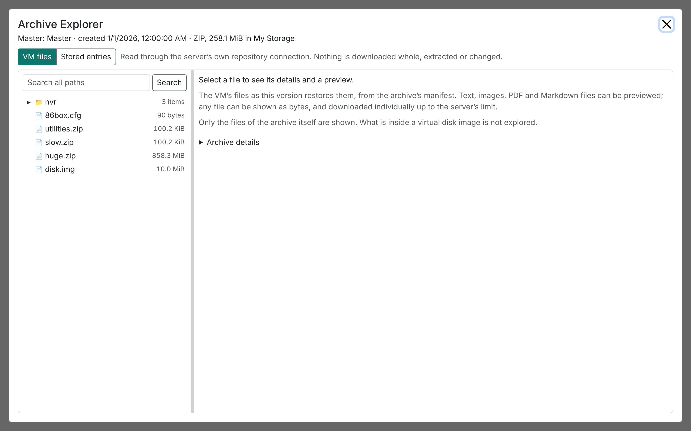 | 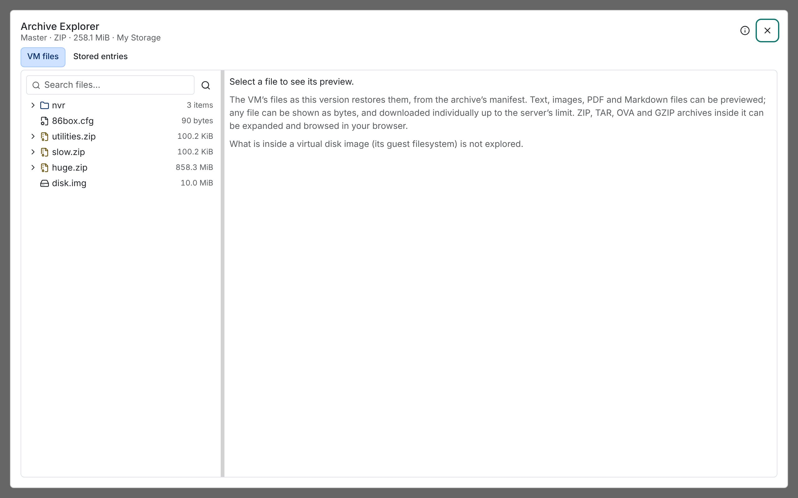  |
| 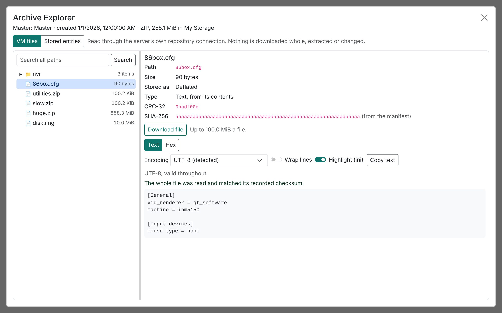     | 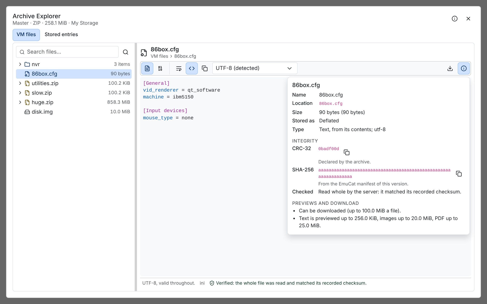 |
| 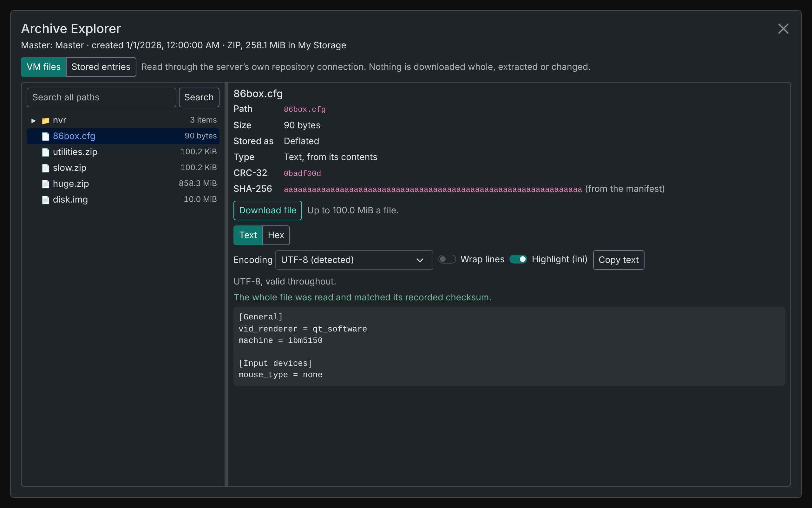     | 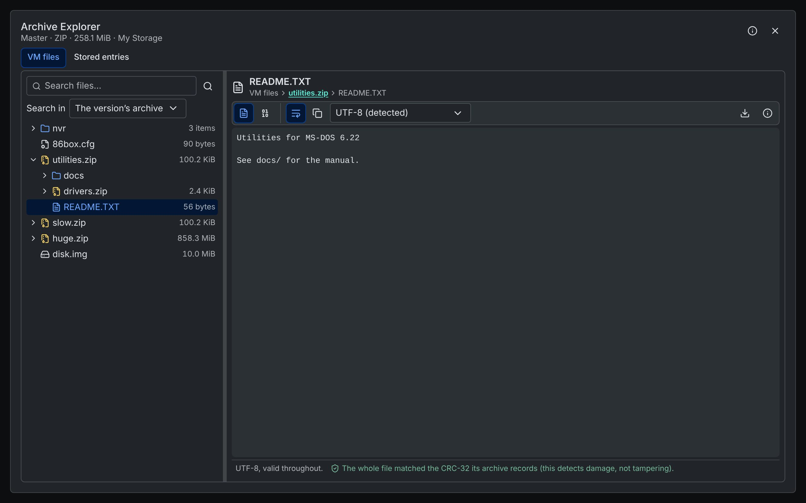      |
| 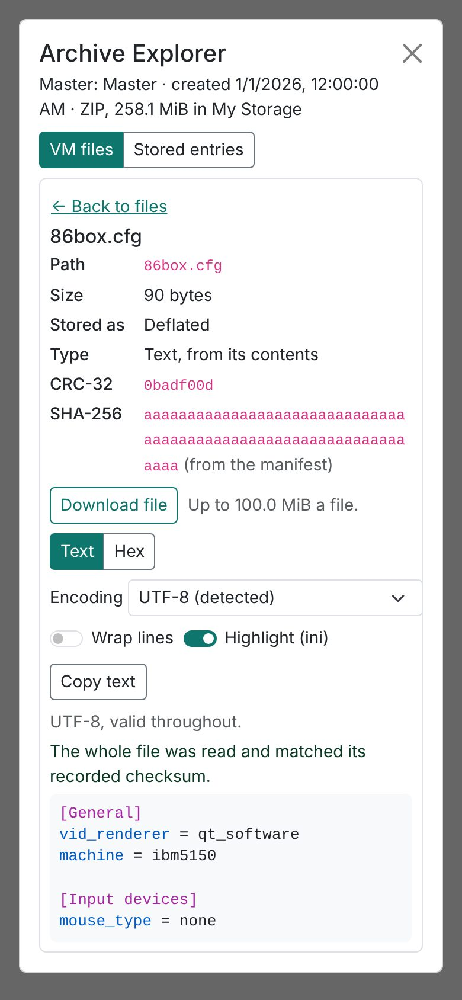   | 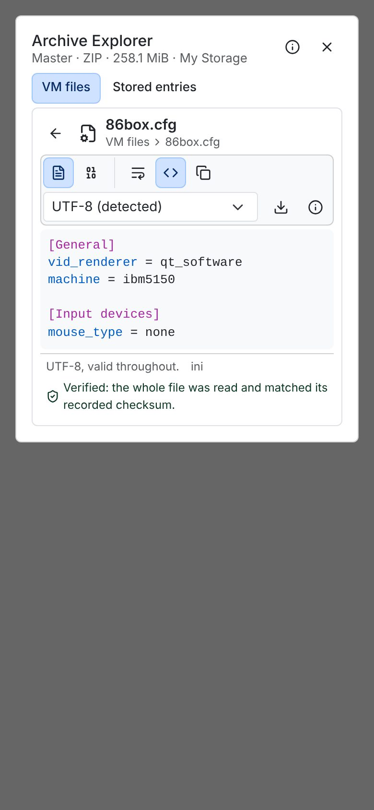    |

Nested archives (new): 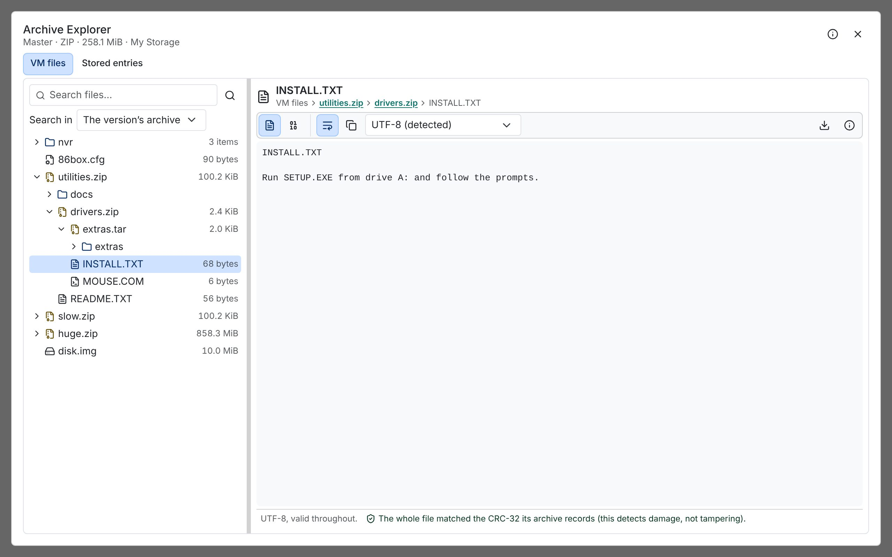
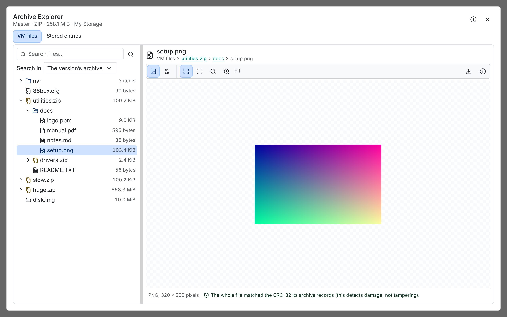 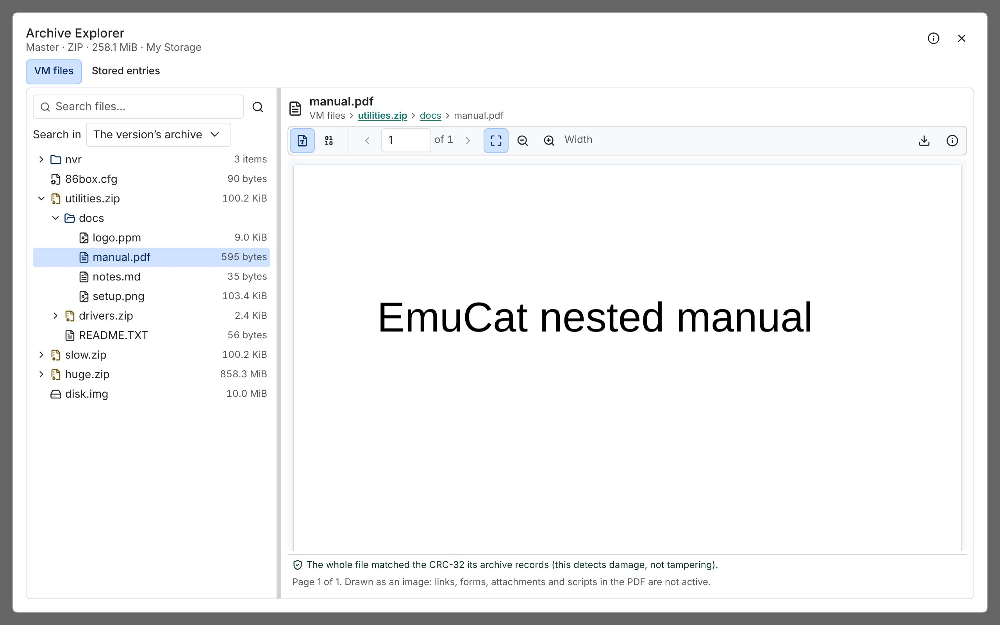

## 11. Archive library assessment

| Library                      | Formats (as tested or read in source)                | Bounded output while decompressing                       | Worker / WASM              | Licence               | Verdict                                                           |
| ---------------------------- | ---------------------------------------------------- | -------------------------------------------------------- | -------------------------- | --------------------- | ----------------------------------------------------------------- |
| `fflate` 0.8.3               | Deflate, GZIP, ZIP (method 8; no ZIP64 in its unzip) | Yes: streaming `Inflate`, chunk callbacks, 4 KiB pushes  | Pure JS, any worker        | MIT                   | **Used** for inflate and GZIP bodies                              |
| `@zip.js/zip.js`             | ZIP, ZIP64, AES/ZipCrypto, Deflate64 (opt.)          | Output via writers; own worker pool via blob/URL scripts | Own workers; optional WASM | BSD-3-Clause          | Not needed: ZIP reader is ~250 lines                              |
| `JSZip`                      | ZIP                                                  | No: inflates an entry whole                              | Main thread                | MIT/GPLv3             | Rejected                                                          |
| `libarchive.js`              | 7z, RAR, CAB, LHA, ARJ, TAR.*, ISO…                  | No: extracts entries whole into memory                   | WASM (~1 MiB) + worker     | MIT (+BSD libarchive) | Rejected: unbounded, and opens disk images                        |
| Native `DecompressionStream` | deflate-raw, gzip                                    | Pull-based                                               | Built in                   | —                     | Viable; fflate chosen for deterministic slicing and tests in Node |

Maintenance: fflate 0.8.3 (2026-05), stable API since 2021. Bundle: the archive worker, fflate inflate included, is
40.6 kB. No WebAssembly anywhere.

## 12. Selected dependencies and rationale

`lucide-react@1.69.0` (icons), `fflate@0.8.3` (bounded inflate, pure JS). Development only:
`playwright-core@1.56.1`, the version `apps/api` already pins, for the browser suite.

## 13. Licensing

lucide-react: ISC (portions MIT from Feather, in its LICENSE). fflate: MIT. playwright-core: Apache-2.0 (dev only).
None has runtime dependencies. All are permissive and compatible with EmuCat's use.

## 14. Browser-local architecture

Page → existing API (`entry`, `entry/download`) → one `ArrayBuffer`, **transferred** to the worker (no copy) → the
worker's `ArchiveHost` (cache) → `LocalArchive` (index, reads) → answers copied or transferred back. `FileSource`
(`remoteSource`, `nestedSource`) lets the file panel and all viewers serve both origins. Sequence diagram: decision 0058.

## 15. Recursive navigation

A tree row for an archive has its own expansion state, separate from selection. Click on the name selects it; the
chevron, Right arrow or **Browse this archive** expands it. Nested directories are synthesized from paths (explicit
directory entries included) and paged by 200 like the server's. Each branch has its own loading, error and retry
rows. Errors never affect other rows. Collapse keeps an archive in memory; collapse while loading cancels it.

## 16. Virtual paths and identities

Row keys: `R␀<server path>`, `L␀<archive id>␀#<entry index>`, `L␀<archive id>␀/<directory>`. NUL never occurs in a
path. The keys are URL-encoded for the DOM: the keyboard test showed that `CSS.escape` maps NUL to U+FFFD, so a raw key
could not be found again. Archive ids are issued by the client (`nested-<n>`). Display paths join segments with `›`. The
breadcrumb is built from the structured ancestors, never by splitting a string. Duplicates, `..`, absolute paths,
archive-like directory names and identical names in different branches cannot collide.

## 17. Archive formats

| Format                                           | Listing                    | Extraction | Recursive | Compression                              | Encryption       | Integrity                    | Tests                                    |
| ------------------------------------------------ | -------------------------- | ---------- | --------- | ---------------------------------------- | ---------------- | ---------------------------- | ---------------------------------------- |
| ZIP / JAR                                        | Yes                        | Yes        | Yes       | Stored, deflate; others listed, not read | Listed, not read | CRC-32 of whole reads        | engine, client, jsdom UI, browser        |
| ZIP64                                            | Yes                        | Yes        | Yes       | As ZIP                                   | As ZIP           | CRC-32                       | engine                                   |
| TAR                                              | Yes                        | Yes        | Yes       | None                                     | —                | None in format (`complete`)  | engine, jsdom UI, browser                |
| OVA                                              | Yes                        | Yes        | Yes       | None                                     | —                | None in format               | engine (0, 1, 2 end blocks; truncations) |
| GZIP (one file)                                  | Yes                        | Yes        | Yes       | Deflate                                  | —                | Trailer CRC-32 and size      | engine                                   |
| TAR.GZ / TGZ                                     | Yes                        | Yes        | Yes       | Deflate (whole stream, ≤ 64 MiB)         | —                | Trailer CRC-32; entries none | engine                                   |
| 7z, RAR, BZIP2, XZ, Zstandard, CAB, ARJ, LHA, .Z | No (recognized, explained) | No         | No        | —                                        | —                | —                            | engine (7z, RAR signatures)              |

## 18. Nested preview formats

| Format                         | Nested                 | How                                                  |
| ------------------------------ | ---------------------- | ---------------------------------------------------- |
| Text, all encodings, highlight | Yes                    | Same viewer                                          |
| Markdown                       | Yes                    | Same Lute rendering and sanitizer                    |
| PNG, JPEG, GIF, WebP, BMP, ICO | Yes                    | Header dimensions checked, then the browser draws it |
| PPM, PCX, TGA                  | Yes                    | Ports of the server's bounded decoders, canvas → PNG |
| TIFF                           | **No** (hex, download) | No bounded browser decoder added                     |
| PDF                            | Yes                    | Same PDF.js setup, from bytes                        |
| Hex                            | Yes                    | Stored: any offset; deflated: first 16 MiB           |

## 19. Nested file download

Produced in the worker (`whole`, ≤ 100 MiB decompressed, CRC-32 checked for ZIP/GZIP), transferred to the page,
saved through a `blob:` URL revoked after 10 s, with a sanitized name (no control or reserved characters, no
separators, never empty). Cancel aborts it. The nested archive itself is downloaded through the server like any
top-level file. The jsdom and browser suites both compare the saved bytes with the fixture's.

## 20. Search

Server search of the version's archive unchanged. **Search in › Opened archives** filters the indexes held in the
page (case-insensitive path substring, first 500 shown, total counted), says that unopened archives were not
searched, and makes no request.

## 21. Memory limits and cache

Limits are listed in decision 0058 §5. Payload 64 MiB rather than 100: a download is briefly a Blob and an
ArrayBuffer. Cache 128 MiB of payloads owned plus an index estimate; LRU; a branch's descendants go with it; what is
shown and the new archive's ancestors are protected; refusal rather than invalid descendants. Stored nested archives
are views (zero cost); deflated ones are copies. Nothing is persisted (a test checks that `localStorage.setItem` is
only ever called for the split width, which existed before).

## 22. Worker

One module worker per open dialog, started lazily, terminated on close. 40.6 kB (194 kB before the contracts alias
kept zod out). Structured messages with operation ids, cancel messages, cooperative checkpoints (4 KiB inflate slices,
64 image rows, 512 entries), 60 s deadlines, errors as codes with fixed words.

## 23. Cancellation and concurrency

Covered by tests: abort while the worker reads (answered at once, `cancel` sent, late answer dropped), cancel of an
open that had already finished (released), worker failure (pending requests fail, branches released, a new worker
next time), 2 opens at once with 4 waiting (`busy` beyond), aborted waiters leave the queue, collapse during download
(nothing opened), close during download (API request aborted, worker terminated), selection changes (the panel
remounts and aborts), StrictMode's mount-time cleanup.

## 24. Security and integrity

ZIP: single disk, ZIP64 records, data before the central directory, local header name/method match, encrypted and
strong-encrypted flags, unknown methods, Unix links/devices, reparse points, directories with data. TAR: 0057's
endings, checksums (signed or unsigned), PAX/GNU limits, sizes within the file, links and devices never read. Paths:
absolute, `..`, drive letters, control characters, more than 4096 bytes: listed whole, never read. Bombs: output is
bounded by the declared size and the limit while inflating (a 32 MiB-zeros entry, an entry lying about its size and
a GZIP bomb are tested). A self-nesting ZIP stops at depth 5. Images: dimensions are checked before decoding. Markdown,
HTML, SVG and PDF are handled as for top-level files. Integrity wording: §8 and decision 0058 §9. No CDN, telemetry,
CSP change, iframe or external request (asserted in the browser suite). Archive access stays admin-only: only the
existing admin routes are used.

## 25. Performance

Measured in headless Chromium 1243 (Linux, this container) by `test:browser`, with synthetic archives of incompressible
stored files, 500 small files and one deflated text file (1–8 MiB), from a local server. A single run each; numbers
in milliseconds.

| Archive         | Entries | Download (local) | Index | Extract text (decompressed) | 256 KiB text preview | Retained | Longest page timer gap |
| --------------- | ------- | ---------------- | ----- | --------------------------- | -------------------- | -------- | ---------------------- |
| 1 MiB           | 502     | 12.6             | 21.5  | 17.7 (1 MiB)                | 8.7                  | 1.1 MiB  | 10.1                   |
| 10 MiB          | 504     | 73.9             | 20.0  | 30.6 (2 MiB)                | 22.1                 | 10.1 MiB | 10.3                   |
| 50 MiB          | 514     | 212.7            | 24.2  | 100.5 (8 MiB)               | 10.5                 | 49.9 MiB | 10.2                   |
| 63.5 MiB (≈max) | 517     | 263.6            | 31.2  | 107.1 (8 MiB)               | 9.4                  | 63.5 MiB | 10.2                   |

The page's 10 ms timer never slipped by more than about 0.3 ms while the worker indexed and decompressed, so nothing
froze the UI. A three-level archive (ZIP › ZIP › TAR) opened and previewed in the browser suite. It was timed only
by the suite's own timeouts, not measured separately. Retained bytes are the cache's own accounting. The tab's real
memory was not measured: worker heaps are not visible to `performance.memory`, and nothing more precise was
available headless. Real downloads over the internet and NAS will dominate. Not measured here.

**Bundles** (`vite build`, minified; gzip as Vite reports it):

| Asset                     | Before (7c4542b)  | After             | Change                           |
| ------------------------- | ----------------- | ----------------- | -------------------------------- |
| `index-*.js`              | 984.9 kB (289.1)  | 1029.4 kB (305.0) | +44.6 kB (+15.9 kB gzip)         |
| `index-*.css`             | 249.3 kB          | 256.0 kB          | +6.7 kB                          |
| `archive.worker-*.js`     | —                 | 40.6 kB           | new; loaded on first nested open |
| `PdfViewer`, `pdf.worker` | 503.2 / 1327.6 kB | 502.8 / 1327.6 kB | unchanged                        |

## 26. Automated tests

| Suite                                             | Result                      | Notes                                                                                                                                                                     |
| ------------------------------------------------- | --------------------------- | ------------------------------------------------------------------------------------------------------------------------------------------------------------------------- |
| Web (`pnpm --filter @emucat/web test`)            | **602 passed** (556 before) | +29 engine, +6 client, +11 nested UI; 19 Archive Explorer tests rewritten to prove the new layout, none loosened                                                          |
| Web browser (`test:browser`)                      | **8 passed**                | Chromium 1243 via `EMUCAT_BROWSER_PATH`                                                                                                                                   |
| Contracts                                         | **448 passed**              | Unchanged package                                                                                                                                                         |
| API, database-free (`verify` set + archive units) | **167 passed**, 2 skipped   | `config`, `auth-units`, `system-routes`, `media-decoders`, `deployment-units`, `tar-termination`, `archives`, `archive-extract`; the real-OVA test skips without its file |
| Type checks (`pnpm -r check`)                     | Pass                        |                                                                                                                                                                           |
| ESLint, Prettier                                  | Pass                        |                                                                                                                                                                           |

Two defects were found by the new tests and fixed before the push: the worker kept an archive whose open finished
just as it was cancelled (client test), and under React StrictMode the dialog disposed its client permanently on
mount, so every nested open said "cancelled" (browser test). The jsdom nested suite now renders under StrictMode too.

## 27. E2E validation

| Run here                                                                                                                                                                                                                                                                                                      | Not run here, and why                                                                                                                                                                                                                                                                                                                                                                      |
| ------------------------------------------------------------------------------------------------------------------------------------------------------------------------------------------------------------------------------------------------------------------------------------------------------------- | ------------------------------------------------------------------------------------------------------------------------------------------------------------------------------------------------------------------------------------------------------------------------------------------------------------------------------------------------------------------------------------------ |
| `test:browser`: production bundle, nginx MIME and `nosniff`, workers, nested ZIP › ZIP › TAR, text/Markdown/PNG/PPM/PDF, inner download with exact bytes, size limit, close during download and reopen, dark, narrow (no horizontal scroll), no external request, no console error, screenshots, measurements | `pnpm test:e2e` (`apps/api/e2e`): needs MariaDB, Docker (OpenSSH container), the compiled agent and Edge/Chrome. The Docker daemon is not available in Claude Code Web, and these tests cover no code this milestone changed. No Archive Explorer test was added there: it would need a registered version with a nested archive in a real repository, and could not be run before pushing |

To run the rest on the Windows workstation:

```powershell
pnpm db:up
pnpm test
cargo test --manifest-path agent/Cargo.toml --no-fail-fast
pnpm test:e2e
pnpm --filter @emucat/web test:browser
pnpm test:compose
pnpm test:deploy
```

## 28. Production builds

`pnpm --filter @emucat/web build` succeeds (Vite's usual "chunk larger than 500 kB" notice for `index` and the
PDF.js chunk, as before). The worker is emitted as `.js`; no `.mjs` or `.wasm` under `assets/`. `docker build` of
the images (`web.Dockerfile` runs `check` and the web tests in its `verify` stage), `pnpm test:compose` and
`pnpm test:deploy` were **not run**: no Docker daemon. Nothing in `deploy/` changed.

## 29. Important changed files

- `apps/web/src/components/ui/` (new): `IconButton.tsx`, `Popover.tsx`, `FileTypeIcon.tsx`
- `apps/web/src/components/ArchiveExplorer.tsx`, `archive-explorer/{FilePanel,Tree,viewers,PdfViewer,problems}.tsx`,
  `archive-explorer/{chrome.tsx,source.ts}` (new)
- `apps/web/src/archive-local/` (new): engine, readers, worker, client, limits
- `apps/web/src/styles.css`, `vite.config.ts` (contracts alias), `tsconfig.json`, `package.json`, `pnpm-lock.yaml`
- Tests: `apps/web/test/archive-local/*`, `archive-nested.test.tsx`, `archive-explorer.test.tsx`,
  `versions.test.tsx`; `apps/web/e2e/*` (browser suite and harness)
- Docs: decision 0058, `archive-explorer.md`, `runbook-0058-mars.md`, `testing.md`, `deployment.md`,
  `architecture.md`, `README.md`, this report and its screenshots

## 30. Known limitations

- A nested archive is transferred whole once (up to 64 MiB, and never more than the server's single-file limit).
- 7z, RAR, CAB, ARJ, LHA, BZIP2, XZ, Zstandard, Deflate64 and other ZIP methods, encrypted entries, multi-volume and
  self-extracting archives are not opened.
- TIFF inside a nested archive is hex and download only.
- A deflated nested entry's hex view reaches its first 16 MiB only. TAR.GZ is decompressed whole when opened (≤ 64 MiB).
- Multi-member GZIP files fail their check (rare).
- Search of opened archives filters what is loaded. It is not indexed server-side and covers only archives opened in
  this dialog and view.
- The cache budget is an accounting of retained data, not of the tab's memory (decision 0058 §6).
- Each view (VM files / Stored entries) opens its own copy of a nested archive.
- Guest filesystems (ISO, VHD, VDI, VMDK, QCOW2, FAT, NTFS, ext…) are not explored, by design.

## 31. Configuration and infrastructure impact

None. No variable, no Compose, nginx, reverse-proxy, Cloudflare, SSH, repository, schema or agent change. The web
container serves one more `.js` asset.

## 32. Mars deployment runbook

[runbook-0058-mars.md](../runbook-0058-mars.md): checks (status, check-update, check, tooling diff), backup,
`emucatctl update`, post-checks (revisions, health, worker asset type, headers, logs), browser cache note.

## 33. Mars functional acceptance checklist

[runbook-0058-mars.md §5](../runbook-0058-mars.md#5-functional-acceptance-checklist-mars): 43 items, with a safe way to
make a nested-archive fixture without touching production VMs.

## 34. Rollback

`sudo /opt/emucat/tooling/bin/emucatctl rollback-app --to <previous>`, then reload browser tabs. No migration, so no
database restore. Nothing is stored server-side or in browsers.

## 35. Git

Commits on `develop`, pushed to `origin/develop` (the feature, then this documentation). `main` untouched. Nothing
deployed to MARS or MOON.

## Mandatory questions

| Question                                               | Answer                                                                                                                                                                                                                            |
| ------------------------------------------------------ | --------------------------------------------------------------------------------------------------------------------------------------------------------------------------------------------------------------------------------- |
| Lucide integrated as a reusable capability?            | Yes: `lucide-react` plus `components/ui` primitives                                                                                                                                                                               |
| Areas using Lucide                                     | Archive Explorer only (dialog, tree, file panel, viewers, errors)                                                                                                                                                                 |
| All applicable preview actions in contextual toolbars? | Yes (§7)                                                                                                                                                                                                                          |
| All previously exposed metadata still available?       | Yes, in File and Archive information, plus more (what each value rests on)                                                                                                                                                        |
| More usable preview space?                             | Yes: content starts about 27% instead of about 60% down the dialog at 1280 × 800; the preview fills to the status bar                                                                                                             |
| Nested formats actually supported                      | ZIP, JAR, ZIP64, TAR, OVA, GZIP, TAR.GZ/TGZ                                                                                                                                                                                       |
| Evaluated, not implemented                             | 7z, RAR, BZIP2/TAR.BZ2, XZ/TAR.XZ, Zstandard, CAB, ARJ, LHA/LZH, .Z, ZIP methods other than stored/deflate                                                                                                                        |
| ZIP64 and OVA without end marker?                      | Yes, both, with tests (0, 1 and 2 end blocks; truncations refused)                                                                                                                                                                |
| Maximum nesting depth                                  | 5                                                                                                                                                                                                                                 |
| Maximum nested archive size                            | 64 MiB, and never above the server's single-file limit (100 MiB by default)                                                                                                                                                       |
| Memory and decompression limits                        | Cache 128 MiB retained (accounting); entries 20 000; text 256 KiB; hex 64 KiB, seek 16 MiB; image 20 MiB and 16.7 MP; PDF 25 MiB; inner download 100 MiB decompressed; output never exceeds the declared size; 60 s per operation |
| Is an entire outer master or snapshot ever downloaded? | No                                                                                                                                                                                                                                |
| Is an entire nested archive downloaded when expanded?  | Yes, the outermost one, once, through the existing single-file download                                                                                                                                                           |
| Deeper levels processed locally?                       | Yes, in the worker, from bytes already held                                                                                                                                                                                       |
| Nested previews entirely in the browser?               | Yes                                                                                                                                                                                                                               |
| Existing preview formats not reproduced locally        | TIFF                                                                                                                                                                                                                              |
| Individual nested files downloadable?                  | Yes, up to 100 MiB, with CRC-32 checked where the format has one                                                                                                                                                                  |
| Archive payloads persisted in browser storage?         | No                                                                                                                                                                                                                                |
| Server-side temporary files?                           | No                                                                                                                                                                                                                                |
| Workers and cached resources released?                 | Yes: worker terminated on close; branches released on eviction; URLs revoked; PDF documents destroyed                                                                                                                             |
| External runtime network requests?                     | No (asserted in the browser suite)                                                                                                                                                                                                |
| API runtime files modified?                            | No                                                                                                                                                                                                                                |
| API endpoints or contracts changed?                    | No (`packages/contracts` untouched; a web-only build alias imports one of its compiled modules)                                                                                                                                   |
| Windows agent modified?                                | No                                                                                                                                                                                                                                |
| Database migrations?                                   | No                                                                                                                                                                                                                                |
| Configuration changes?                                 | No                                                                                                                                                                                                                                |
| Reverse-proxy changes?                                 | No                                                                                                                                                                                                                                |
| Deployment tooling refresh?                            | No, for a host on decision 0055's tooling or later (the runbook checks it)                                                                                                                                                        |
| Exact commands on Mars                                 | Runbook §2–4: `emucatctl status`, `check-update`, `check`, tooling diff, `backup`, `update`, then the checks                                                                                                                      |
| Tests not executed in Claude Code Web                  | `pnpm test:e2e`, the MariaDB-backed API tests, the agent's `cargo test`, `pnpm test:sftp`, `pnpm test:compose`, `pnpm test:deploy`, Docker image builds (§27–28)                                                                  |
