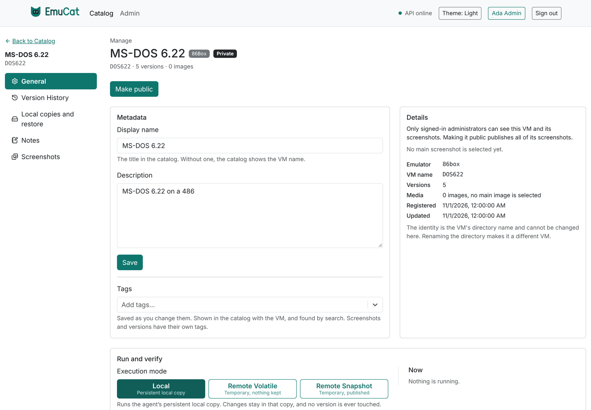
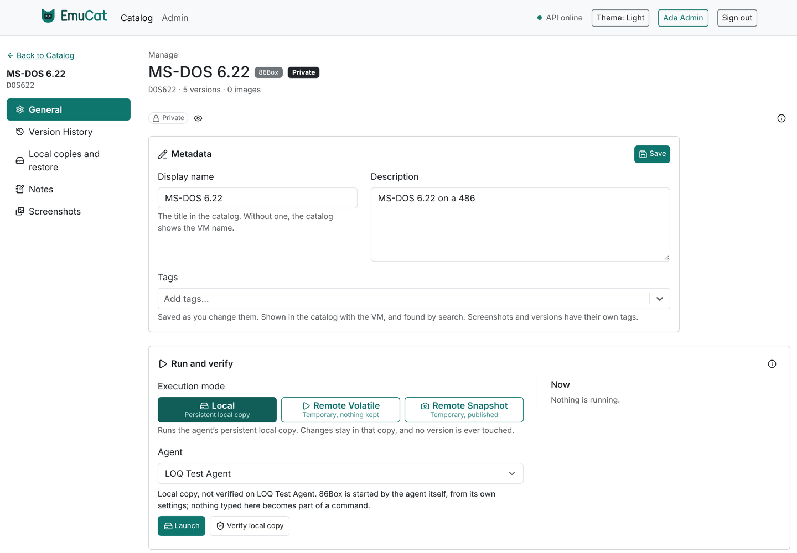
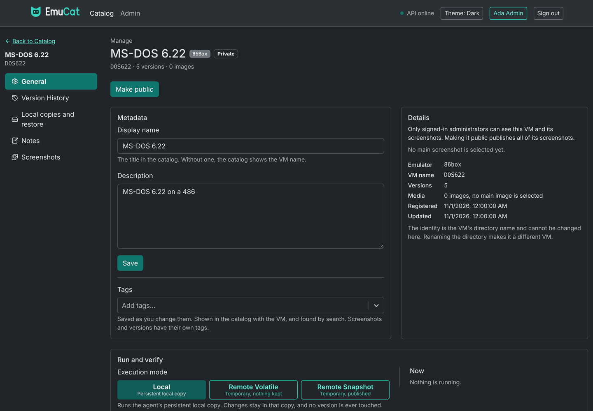
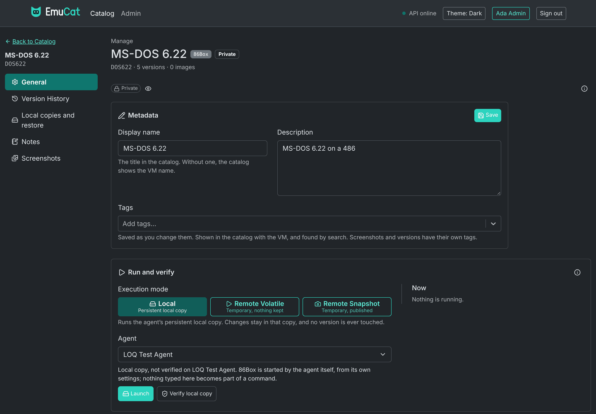
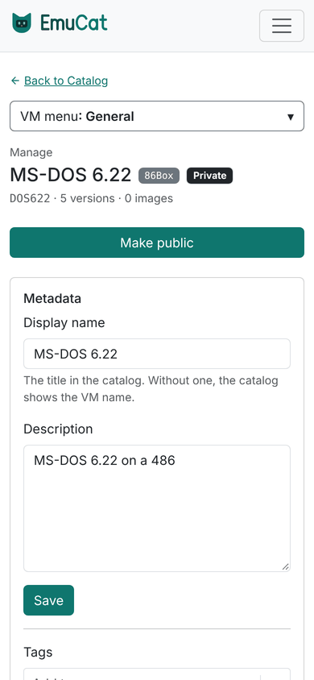
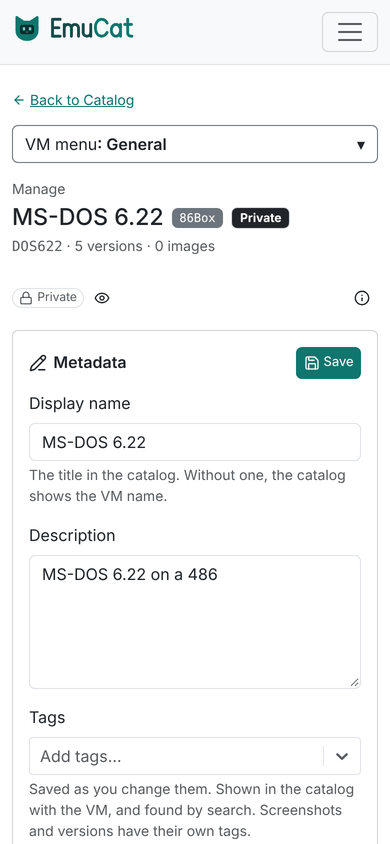
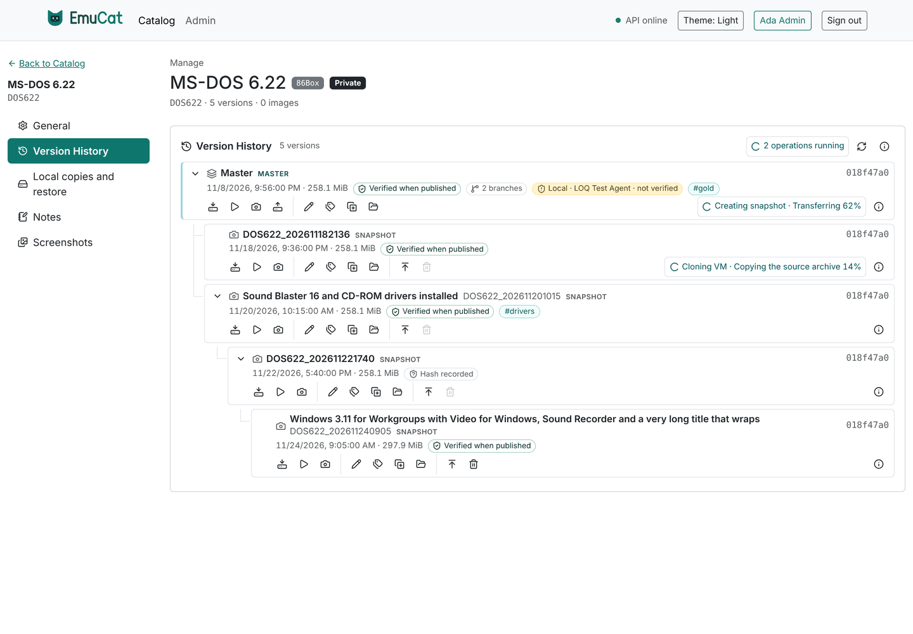

# EmuCat — VM operation visibility and General UI refinement: implementation report

Decision: [0060](../decisions/0060-operation-visibility.md). Runbook: [runbook-0060-mars.md](../runbook-0060-mars.md).
Branch `develop`. Nothing was merged into `main`, and nothing was deployed to MARS or MOON.

## 1. Executive summary

Snapshot synchronization (from a local copy, from Remote Snapshot, from Run and snapshot), remasters and VM clones
(from a master or a snapshot) are now visible in Version History and General, from the server's own durable record.
An operation is drawn on the version it concerns with an animated Lucide `LoaderCircle`, its phase and, when the
agent or server measured it, a percentage; it survives navigation, refresh, browser restart and API restart; endings
are announced and kept in view as notices; the tree refreshes itself when a snapshot is published. General was
redesigned with a Lucide toolbar, the Details panel moved into a VM Info panel, and Run and verify got icons, an Info
panel and an "archive operations" area kept apart from emulator sessions.

The preliminary assessment showed that the server already persisted every phase and byte count, and the agent
already reported them over both SFTP and the HTTPS relay. The gap was in the frontend (operation ids held only in
React state) and one missing query (clones _from_ a VM). The fix is therefore one additive, read-only API route and
frontend work. **No database migration, no agent change, no protocol change, no configuration or tooling change.**

## 2. Starting branch and commit

- `develop` at `6280823` ("docs: Version History refinement (decision 0059)…"), fetched from `origin/develop`
  (13 commits ahead of the stale local checkout, fast-forwarded). Working tree clean; no unrelated work to preserve.
- Git identity set to `david <davidfriscia@gmail.com>` for this repository.

## 3. Preliminary architecture assessment

Traced in the code (paths relative to the repository):

| Step                      | Snapshot of local copy                                                                   | Remote Snapshot / Run and snapshot                                                      | Clone (master or snapshot)                                                       |
| ------------------------- | ---------------------------------------------------------------------------------------- | --------------------------------------------------------------------------------------- | -------------------------------------------------------------------------------- |
| User action               | Version card › upload icon › dialog                                                      | Version card › camera › General › Start Remote Snapshot                                 | Version card › copy-plus › dialog                                                |
| Frontend request          | `POST …/snapshots` (`Snapshots.tsx`)                                                     | `POST …/workspaces` (`Execution.tsx`)                                                   | `POST …/versions/:id/clone` (`Clone.tsx`)                                        |
| API acceptance            | `RegistrationCoordinator.createSnapshot`, 202                                            | `WorkspaceCoordinator`, 202                                                             | `CloneCoordinator.request`, 202                                                  |
| Identity                  | `registration_operations.id`, `request_id` idempotent                                    | `vm_workspaces.id`; later a snapshot registration, request id from (workspace, attempt) | `registration_operations.id`, `request_id`                                       |
| Execution                 | Agent (`agent/src/registration.rs`)                                                      | Agent restore → launcher session → on exit, snapshot registration                       | Server (`apps/api/src/clones/server-runner.ts`), no agent                        |
| Intermediate states       | `agent.registration_progress` stages + bytes, throttled 2 s; `STAGE_ALLOWED_FROM` guards | Workspace `preparing → ready/running → publishing`, then as snapshot                    | `serverProgress` with the same stages and guards                                 |
| Transfer and verification | Agent `ArchiveRepository`: SFTP or relay (`relay.rs`, `transfers/service.ts`)            | As snapshot                                                                             | Server SFTP (`repository-access/ssh.ts`)                                         |
| Publication               | No-overwrite hard-link publication; agent verifies                                       | As snapshot                                                                             | Server verifies and publishes                                                    |
| Database                  | Result → commit version → `cleaning_local` → `succeeded`                                 | Same; workspace discarded after                                                         | `commitServerClone`: VM, master, provenance in one transaction → `succeeded`     |
| Terminal failure          | `failed`/`cancelled` with `error_code`, `recovery`                                       | Same; workspace `publish_failed` keeps the copy                                         | `serverFailed`; restart retries ≤ 3 (`server_attempts`), then `server_restarted` |
| Frontend notification     | **Only** `SnapshotProgress` polling one id held in React state                           | `RemoteSessionCard` steps on General (workspace polling)                                | **Only** `CloneProgress` polling one id held in React state                      |

Available to the frontend before: everything per operation through `GET /admin/registrations/:id`, and per-VM
listing through `GET /admin/registrations?vmName=` — but only for rows of that VM.
Unavailable: which operations concern a VM after navigation (no client state survived), and clones made _from_ a VM
(their row's `vm_name` is the destination).

## 4. Root causes of missing operation visibility

A combination of two causes, neither in the agent or the database:

1. **Missing frontend state recovery.** `Versions.tsx` kept `snapshotOperation` and `clones` in component state. On
   leaving Version History, refreshing or reopening the browser the ids were lost; nothing asked the server again.
2. **Missing API exposure / correlation for clones.** No route returned the clones whose _source_ is a VM's version.

Not causes: persistent state (complete), agent progress reporting (stages and bytes already sent, throttled, over
both transports), terminal-state reporting (complete and guarded).

## 5. Existing operation lifecycle inventory

| Operation                    | Record                                                         | Same lifecycle infrastructure? | Included now                                                                  |
| ---------------------------- | -------------------------------------------------------------- | ------------------------------ | ----------------------------------------------------------------------------- |
| Snapshot of a local copy     | `registration_operations` (`snapshot`)                         | Yes                            | **Yes** (mandatory)                                                           |
| Remote Snapshot publication  | `registration_operations` (`snapshot`, `workspace_id`)         | Yes                            | **Yes** (mandatory)                                                           |
| Clone from master / snapshot | `registration_operations` (`clone`)                            | Yes                            | **Yes** (mandatory)                                                           |
| Remaster from local copy     | `vm_remaster_operations` + registration (`remaster`)           | Yes                            | **Yes**: same rows, no extra cost; page-level only (no single source version) |
| Promote to master            | `vm_remaster_operations` (`snapshot`), committed when recorded | No background transfer         | No: nothing to follow; existing `RemasterProgress` kept                       |
| Delete snapshot              | `vm_version_deletions`                                         | No                             | No: already shown on its card ("Being deleted")                               |
| Restore                      | `restore_operations`                                           | No (another table)             | No: shown on Local copies and restore; adding it would widen the scope        |
| VirtualBox machine snapshot  | registration (`snapshot`)                                      | Yes                            | Yes, naturally                                                                |

## 6. Snapshot synchronization lifecycle

`queued` (agent not yet started, or offline → **Waiting for the agent**) → `validating` (**Checking the copy**) →
`archiving` (**Packaging**, bytes) → `uploading` (**Transferring**, bytes; SFTP or relay) → `verifying`
(**Verifying**, bytes; a failed verification goes back to uploading) → `committing` (**Publishing**) →
`cleaning_local` (**Finalizing**) → `succeeded` / `partial_success` / `failed` / `cancelled`.
A Remote Snapshot has no registration while its emulator runs (workspace `running`): General shows the session,
Version History and the operation summary show nothing running. The registration appears when the emulator has
ended; only then does "Publishing Remote Snapshot" appear. Completion is reported only at `succeeded`, i.e. after the
version is committed, as before.

## 7. Clone lifecycle

`queued` (**Queued on the server**) → `validating` (**Checking the source**) → `archiving` (**Copying the source
archive**: reading and rewriting with the new manifest, bytes) → `uploading` (**Writing the new archive**, bytes) →
`verifying` (**Verifying the new archive**) → commit (**Registering the new VM**) → `succeeded`. Completion is the
existing definition: the commit of VM, master and provenance. The destination VM record does not exist before; the
interface says "reserved; created when the clone completes". A server clone never "waits for an agent".

## 8. Selected operation tracking architecture

The existing `registration_operations` record, read through one new route
`GET /api/v1/admin/vms/:emulatorType/:vmName/operations`, and one shared frontend provider per VM. No new table,
state machine, event stream or WebSocket.

## 9. Reused operation infrastructure

- `registration_operations` rows, `toOperation`, `OPERATION_QUERY`, `registrationRecovery` (API).
- `RegistrationOperation` schema, unchanged (contracts).
- `ix_registration_vm_created`, `ix_registration_clone_source` (no new index).
- `agent_repositories.last_transport` (decision 0055) for the transport hint.
- `usePolledData` (non-overlapping, abortable, stale-proof, visibility-aware polling) (web).
- `InfoPopover`, `IconButton`, `Toolbar`, `StatusChip`, `icon-spin` with `prefers-reduced-motion` (web).

## 10. Operation identity and correlation

- Identity: `operation.id` (unchanged). Relation: `this_vm` or `clone_source`.
- VM: the URL's VM; for a clone, `operation.vmName` is the destination and `cloneSource.vmName` the source.
- Source version: snapshot → `parentVersionId`; clone → `cloneSource.versionId`; remaster → none (page level).
  Never by display name (`vmOperationSourceVersionId`).
- Agent: `agentId`/`agentName`/`agentOnline`, or `performedBy: server`.
- Repository: `repositoryName`. Resulting version: `versionId`, labelled "reserved" until `succeeded`.
- Concurrency: unchanged. Several operations at once are shown separately (the database still allows at most one
  active registration per VM name and per agent, which is existing behaviour; clones of one source into several new
  names run concurrently).

## 11. Authoritative state model

`vmOperationPhase(operation)` (contracts) maps recorded state (+ `agentOnline` for agent work) to the normalized
phases of decision 0060 §2. The browser adds only two presentation states, both explicit about what they are:
**status unavailable** (latest listing request failed; last known state shown, no spinner) and the 202 answer shown
until a listing includes it.

## 12. Progress reporting semantics

Indeterminate by default. Determinate text ("Transferring 62%") only during `archiving`, `uploading`, `verifying`
when bytes are recorded; floored; never 100% while non-terminal (a stage with all bytes done shows only its name);
not shown while waiting for an agent. The details panel says the percentage is the current phase's byte count only.
No estimate from time anywhere.

## 13. Version History indicators

`VersionOperations` at the end of each card's toolbar, between `ToolbarSpacer` and Info. One operation: icon, title
and phase ("Creating snapshot · Transferring 62%"); several: "2 of 2 operations running" with a list. The card's toolbar
stays one row on a 1440 px window (browser-tested). Expanded branches are preserved on refresh.

## 14. Page-level aggregate indicators

`OperationsSummary` in the Version History header and in General's toolbar: "N operations running", or
"N recent operations", or "Operation status unavailable"; nothing when there is nothing to show. It covers collapsed
branches, remasters and multiple operations, and names each operation's version.

## 15. Operation details panels

`OperationDetails`: operation type, status, identifier, requested by; progress (bytes, percentage, semantics note);
source VM and version, destination VM (link once created), new snapshot name, reserved/resulting version; performed
by (agent online/offline or server), repository, transport (with what it rests on); started, last update, finished,
elapsed (against the server's clock); failure code, message and recovery; where cancellation exists
(Admin › Registrations); dismiss for ended operations. No credentials, keys, hosts or paths.

## 16. Completion and failure feedback

`OperationNotices` above the tree and on General: success (`CircleCheck`, green), failure (`CircleX`, red, with error
and recovery), partial success/cancellation (`CircleAlert`). A clone's success links to the new VM; no automatic
navigation. One polite live-region announcement per ending. The card indicator changes to the final state too.

**Retention and presentation policy.** Server: listed while active, while a partial success is unacknowledged, and
24 h after `finished_at`; records are never deleted. Browser: successes shown 30 min after they finished, failures
until dismissed or until the server stops listing them; dismissal stored per browser (`emucat.operations.dismissed`,
last 200 ids, failures of storage tolerated). Dismissing never touches the record.

## 17. Refresh and navigation recovery

The list is fetched from the server on every page load and kept by the VM Manage layout across sections. Browser
refresh, closing and reopening, and General ⇄ Version History all show the same operations (unit- and browser-tested).

## 18. API restart and agent reconnection behaviour

- **API restart**: records persist. Agents reconnect and resynchronize their journals (decision 0015): running ones
  resume, lost ones fail with an explained code. Server clones are restarted from the beginning, failed after 3
  interrupted attempts. The browser sees "status unavailable" during the outage and recovers by itself.
- **Agent disconnection**: the row stays active; the interface shows "Waiting for the agent" without a spinner —
  never success, never failure.
- **Agent reconnection**: progress resumes (spinner returns) or the operation ends with a reason.

## 19. Frontend synchronization strategy

One `VmOperationsProvider` per VM's management: 2 s while any listed operation is active, 15 s otherwise, paused
while the tab is hidden, no overlapping requests, aborted on unmount, stale answers ignored, retried at the interval
after a failure. On an ending: Version History re-reads its tree once (not on every progress update), the layout
re-reads the VM. No new WebSocket or event stream. Polling the existing WebSocket was not an option: it connects
agents, not browsers.

## 20. General page redesign

Inventory before: Make public/private button, View public page link, Metadata (display name, description, Save,
"Saved." alert, validation errors), Tags (auto-save), Details panel (visibility explanation, cover notice, emulator,
VM name, versions, media, cloned from, registered/created, updated, identity note), Run and verify (modes, version,
agent, content text, Launch/Start, Verify, eligibility reasons, Now with session, remote sessions, verification
result; recent remote sessions; session history; QEMU capture). After: see sections 21–23. Navigation unchanged.

## 21. Metadata preservation matrix

| Item                        | Before                      | After                                                                  |
| --------------------------- | --------------------------- | ---------------------------------------------------------------------- |
| Display name, description   | Fields, explicit Save       | Same fields and ids, explicit Save in the section toolbar              |
| Save request                | `PATCH`, blank → `null`     | Unchanged; fields then show what the server kept                       |
| Saved / errors              | "Saved." alert, `FormError` | "Saved" chip (`role=status`), `FormError` unchanged                    |
| Unsaved changes             | Not indicated               | "Unsaved changes" chip (no navigation guard added)                     |
| Tags                        | Auto-save `TagSelector`     | Unchanged                                                              |
| Visibility explanation      | Details                     | Status chip statement, button description, VM Info                     |
| Cover notice                | Details                     | "Cover shown" chip / VM Info; warning (public, no cover) stays in view |
| Emulator, VM name           | Details                     | VM Info › Identity                                                     |
| Versions, media, main image | Details                     | VM Info › Contents (and page header, unchanged)                        |
| Cloned from                 | Details                     | VM Info › History (`ClonedFrom`, link while source exists)             |
| Registered/Created, Updated | Details                     | VM Info › History                                                      |
| Identity explanation        | Details                     | VM Info › Identity note                                                |

## 22. General page action-to-icon mapping

| Action            | Icon (lucide-react 1.69.0)  | Accessible name             | Notes                                           |
| ----------------- | --------------------------- | --------------------------- | ----------------------------------------------- |
| Make public       | `Eye`                       | Make public                 | Tooltip "Make public, with all its screenshots" |
| Make private      | `EyeOff`                    | Make private                | `danger` on hover/focus                         |
| View public page  | `ExternalLink`              | View public page            | `IconLink`: a real link; only while public      |
| VM information    | `Info`                      | VM information              | `InfoPopover`                                   |
| Save metadata     | `Save`                      | Save metadata               | Visible text "Save"; submit button              |
| Discard changes   | —                           | —                           | Not added: not supported before                 |
| Status            | `Globe` / `Lock`, `Image`   | chips                       | Public/Private, Cover shown                     |
| Launch / Start …  | `HardDrive`/`Play`/`Camera` | unchanged names             | Labelled icon buttons                           |
| Verify local copy | `ShieldCheck`               | Verify local copy           | Labelled                                        |
| About running     | `Info`                      | About running and verifying | Explanations of every mode                      |

No publication confirmation existed before and none was added; publication behaviour is unchanged.

## 23. Execution mode presentation

Three labelled radio buttons, unchanged semantics and names, with `HardDrive`, `Play`, `Camera`; the selected mode's
full explanation stays visible under them and every unavailable mode's reason too; all explanations are also in the
section's Info. Version, agent and eligibility texts unchanged.

## 24. Shared UI components

New in `apps/web/src/components/operations/`: `VmOperationsProvider` / `useVmOperations` / `WithVmOperations`,
`OperationIndicator`, `VersionOperations`, `OperationsSummary`, `OperationDetails`, `OperationNotices`, `text.ts`.
Extended in `ui/`: `IconButton` `text` and `iconClassName`; `InfoPopover` `text`, `iconClassName`,
`buttonClassName`; new `IconLink`. Documented in [ui-conventions.md](../ui-conventions.md#background-operations).

## 25. Accessibility and animation

`icon-spin` (local CSS, 1 s linear; 3 s under `prefers-reduced-motion`, browser-verified). Icons `aria-hidden`; the
accessible name carries what, where and the phase. One polite, atomic live region per VM announces endings only
(unit-tested: no announcement for 25 → 75%). Popovers are keyboard-operable, Escape returns focus. 44 px targets on
coarse pointers (existing rule). Tones use Bootstrap emphasis variables; dark-theme contrast checked in the browser
test.

## 26. API changes

One route, additive: `GET /api/v1/admin/vms/:emulatorType/:vmName/operations` (admin, same-origin/CSRF rules as the
group, 404 `vm_not_found`). Contracts: `vm-operations.ts` (schemas and pure helpers). No existing contract changed.

## 27. Database changes

None. No migration (newest remains `0021_server_repository_access`).

## 28. Agent changes

None. `git diff 6280823 HEAD -- agent` is empty. Not needed: progress, phases and terminal reports already exist,
throttled, over both transports.

## 29. Protocol changes

None.

## 30. Compatibility matrix

| Combination                                   | Result                                                                   |
| --------------------------------------------- | ------------------------------------------------------------------------ |
| Existing agent + updated API                  | Supported: the protocol is unchanged                                     |
| Updated agent + existing API                  | Not applicable: no agent update                                          |
| Existing agent reconnecting after API upgrade | Supported: normal resynchronization                                      |
| Mixed agent versions                          | Supported as before; indicators show what each reports                   |
| Updated web + old API (partial rollback)      | Works, operations shown as "status unavailable"; roll back both together |
| Old web + updated API                         | Works; the new route is simply unused                                    |

## 31. Security and operational integrity

Admin-only route behind the existing session/admin/same-origin hooks (401 anonymous, 403 non-admin, tested); no
public route; scoped to the VM, clone rows only through that VM's version ids (tested against another VM); read-only:
it cannot change, associate, complete or duplicate anything. No credential, key, host or path is returned (the
`archiveKey` already present in `RegistrationOperation` is unchanged). Archive verification, publication and staging
are untouched.

## 32. Automated test results

Executed in this environment (Linux container, MariaDB 11.8 in Docker):

| Suite             | Command                                                      | Result                                                                                              |
| ----------------- | ------------------------------------------------------------ | --------------------------------------------------------------------------------------------------- |
| Contracts         | `cd packages/contracts && npx vitest run`                    | 20 files, **456 passed** (8 new)                                                                    |
| API (whole suite) | `cd apps/api && npx vitest run`                              | 45 files, **1223 passed, 2 skipped** (7 new); skipped = real-OVA tests without `EMUCAT_OVA_FIXTURE` |
| Web               | `cd apps/web && npx vitest run`                              | 29 files, **627 passed** (11 new, 9 rewritten for the new behaviour)                                |
| Deployer          | `cd apps/deployer && npx vitest run`                         | 3 files, **51 passed**                                                                              |
| Type checking     | `pnpm -r check`                                              | Passed                                                                                              |
| Lint              | `npx eslint .`, `npx prettier --check .`                     | Passed                                                                                              |
| Agent (unchanged) | `cargo test --manifest-path agent/Cargo.toml --no-fail-fast` | **579 passed, 11 failed** — environment, see §34                                                    |

New API tests (`apps/api/test/vm-operations.test.ts`): a snapshot from request through agent progress to success
with a rejected out-of-order report; an agent going offline; clones listed on the source only; retention and
active-first ordering; how a VM was made not listed; authorization and 404. New web tests
(`apps/web/test/operations.test.tsx`): association, several operations, collapsed branch with preserved collapse,
waiting for agent, no 100%, unavailable status and recovery, failure persistence across General and dismissal,
refresh recovery with one request loop, single announcement, Remote Snapshot execution vs publication, reduced
motion. Rewritten tests: snapshot and working-copy preservation (`versions.test.tsx`), clone flow
(`notes-clone.test.tsx`), General layout, VM Info, unsaved changes (`admin.test.tsx`), cover chips
(`gallery.test.tsx`), request budget (+15 operations listings in 224 s, `virtualbox-management.test.tsx`).

## 33. E2E test results

- **Browser tests** (`pnpm --filter @emucat/web test:browser`, Chromium 1243 via `EMUCAT_BROWSER_PATH`): 3 files,
  **28 passed**, including the new `e2e/operations.browser.test.ts` (9): spinner animation and reduced motion, one
  toolbar row with indicators, details inside the window and focus return, multiple operations on a 390 px phone,
  dark theme contrast, endings and tree refresh, unavailable status and recovery, General toolbar/Info/unsaved/Now,
  same operation in Version History, no non-GET request, no console error.
- **Agent e2e** (`pnpm test:e2e`): **not executed**. It runs on Windows only (DPAPI, Windows agent paths). It exercises
  the real agent/API/SFTP flows; this milestone changed neither the agent nor any existing route. Run it on the
  workstation (section 40). Scenarios of the prompt §28 that need a real agent and repository (real snapshot
  transfer, real server clone, agent disconnection) are covered by the API tests with the scripted agent and the
  server world, and by the MARS checklist items 15–37.

## 34. Cross-platform validation

Linux: everything in §32. Agent on Linux as root: 11 failures independent of this change (agent untouched): six
`ova_import` command-line tests ("no secure credential store is implemented for linux yet", documented in
`docs/testing.md`), three `launcher` unit tests asserting Windows executable paths, and
`a_replaced_directory_is_not_the_one_that_was_archived` and
`a_directory_that_is_not_this_restores_is_never_touched_after_a_crash`, which rely on permission behaviour that root
bypasses. Windows: not available here; see section 40.

## 35. Production build results

`pnpm -r build`: contracts, API, web (Vite), deployer built. Docker images (`deploy/docker/api.Dockerfile`,
`web.Dockerfile`): **not built** — the build container could not complete `corepack install` (no registry access
through this environment's proxy inside Docker builds). The Dockerfiles are unchanged; the images are built by
`emucatctl update` on MARS (`EMUCAT_VERIFY=true` runs the web tests in the image). Compose: unchanged.

## 36. Before-and-after screenshots

In [`assets/operation-visibility-0060/`](assets/operation-visibility-0060/), captured by
`e2e/operations.browser.test.ts` from the production builds of `6280823` (before) and this release (after), same data
and sizes (stand-in API; the data is synthetic).

| General before                                                      | General after                                                      |
| ------------------------------------------------------------------- | ------------------------------------------------------------------ |
|  |  |
|   |   |
|      |      |

General: active operations (light, dark, narrow), VM Info, unsaved changes —
`general-active-light.png`, `general-active-dark.png`, `general-active-narrow.png`, `general-info.png`,
`general-unsaved.png`.

Version History: snapshot synchronization and clone in progress (`vh-active-light.png`, `vh-active-dark.png`),
details (`vh-details.png`), multiple operations on a phone and their details (`vh-multiple-narrow.png`,
`vh-multiple-narrow-details.png`), success and failure (`vh-ended.png`), status unavailable (`vh-unavailable.png`).



## 37. Important changed files

- `packages/contracts/src/vm-operations.ts` (+ test)
- `apps/api/src/registration/coordinator.ts` (`listForVm`), `apps/api/src/routes/admin-versions.ts` (route),
  `apps/api/test/vm-operations.test.ts`
- `apps/web/src/components/operations/{VmOperationsProvider.tsx,OperationStatus.tsx,text.ts}`
- `apps/web/src/components/Versions.tsx`, `apps/web/src/pages/admin/vm/VmManageLayout.tsx`
- `apps/web/src/pages/admin/vm/VmGeneralPage.tsx`, `apps/web/src/components/Execution.tsx`
- `apps/web/src/components/ui/{IconButton.tsx,Popover.tsx}`, `apps/web/src/styles.css`, `apps/web/src/api.ts`
- Tests: `apps/web/test/{operations,versions,notes-clone,admin,gallery,virtualbox-management}.test.tsx`,
  `apps/web/test/mock-api.tsx`, `apps/web/e2e/{operations,version-history}.browser.test.ts`
- Docs: decision 0060, `api.md`, `architecture.md`, `ui-conventions.md`, decisions index, runbook, this report

## 38. Known limitations

- Restore is not shown by the new indicators (different record; Local copies and restore shows it).
- An agent operation's transport is the agent's latest health check, not recorded per operation.
- No cancel or retry button was added; cancellation stays in Admin › Registrations.
- Dismissals are per browser.
- Phases are as fine as the server records: e.g. the commit is one phase, and a Remote Snapshot shows no operation
  between the emulator's exit and the creation of its registration (normally seconds).
- Polling, not push: an ending is seen within 2 s while active, within 15 s for an operation started elsewhere.
- Elapsed time updates with each answer, not every second.

## 39. Configuration and infrastructure impact

Frontend and API deployment: **required** (both images rebuilt by `update`). Database migration: **no**. Agent update,
protocol update, version increment, distribution change: **no**. Tooling refresh, `emucatctl install`: **no**.
Environment variables, Compose, reverse proxy, repository configuration: **no change**. New background processes:
**none**. Resources: one small indexed `GET` per open VM page every 2 s while an operation runs, else every 15 s, none
while hidden. Rollback: safe, application-only (no schema change). Deploy only with no operation running (an API
restart restarts server clones).

## 40. Windows workstation runbook

**Agent code and protocol did not change, so no Windows agent build, version increment, reinstallation,
re-registration or agent restart is required.** Steps 9–20 of the requested runbook (release build, executable,
checksum, packaging, replacement, restart, capability check, rollback of the executable) do not apply.

Recommended validation of the unchanged baseline on the workstation (PowerShell, tool versions from
[testing.md](../testing.md#prerequisites-on-windows-11): Node 22.22.3, pnpm 12.10.1, Rust 1.99.0, Docker Desktop):

```powershell
git fetch origin
git switch develop
git pull --ff-only
git log -1 --format='%H %s'
```

The last line must show the commit pushed for this milestone (see section 45).

```powershell
pnpm install --frozen-lockfile
pnpm db:up
pnpm test
cargo test --manifest-path agent/Cargo.toml --no-fail-fast
pnpm --filter @emucat/web test:browser
pnpm test:e2e
```

Expected: all pass on Windows (the 11 Linux-only agent failures of §34 do not occur there). `pnpm test:e2e` is the
suite that could not run here. With `$env:EMUCAT_BROWSER_SCREENSHOTS` set, the browser tests also write the
screenshots of section 36.

## 41. Exact Mars deployment runbook

[runbook-0060-mars.md](../runbook-0060-mars.md): pre-checks (release, tooling currency, no migration, health, agent
inventory, **no active operation**), backup, `sudo /opt/emucat/tooling/bin/emucatctl update`, post-checks
(revisions, health, `ready`, the new route answering 401 anonymously and 200 to an administrator, logs), the
configuration matrix (no change). Order: application only; **no agent step**.

## 42. Mars functional acceptance checklist

45 items in [runbook-0060-mars.md §5](../runbook-0060-mars.md#5-functional-acceptance-checklist-mars), with
expected results, on disposable test VMs.

## 43. Rollback instructions

`sudo /opt/emucat/tooling/bin/emucatctl rollback-app --to <previous>` with no operation running. No database
restore is needed or recommended (no migration). Operation records are untouched; the browser key
`emucat.operations.dismissed` is ignored by the previous release. No agent, tooling or configuration rollback.
Archives and VMs are never modified by this release.

## 44. Moon promotion considerations

After MARS acceptance you promote `develop` to `main`; on MOON run the same checks against `origin/main`, ensure no
operation is running, `emucatctl update`. No production agent needs updating. Nothing was promoted or deployed here.

## 45. Git commits and push confirmation

On `develop`, pushed to `origin/develop`:

- `df1e692` feat(api): list the operations that concern a VM's versions (decision 0060)
- `453f97e` feat(web): follow snapshot and clone operations in Version History (decision 0060)
- `b9b2e6e` feat(web): Lucide toolbar, metadata editor and VM Info on General (decision 0060)
- the documentation commit containing this report (the tip of `develop`)

Each commit passes type checking and the web/API tests at that point. `main` was not changed.

## Mandatory questions

### Operation visibility

- **Root cause?** Operation ids held only in React state, and no query for clones made from a VM (§4).
- **Mechanisms reused?** `registration_operations`, its guarded state machine and progress columns, agent/server
  progress reporting, `usePolledData`, the Lucide UI primitives (§9).
- **New persistent model?** No.
- **Operations tracked?** Snapshots (local copy, Remote Snapshot, Run and snapshot, VirtualBox), clones from master
  or snapshot, remasters.
- **Authoritative source?** `registration_operations`, via `GET …/operations`.
- **Observable phases?** Queued, waiting for agent, checking, packaging, transferring, verifying, publishing,
  finalizing, and the four endings (§6–7).
- **Determinate or indeterminate?** Indeterminate, with a measured per-phase percentage when bytes are recorded.
- **Survives refresh / navigation / browser restart?** Yes / yes / yes.
- **After API restart?** Records persist; agents resynchronize; server clones restart (≤ 3 attempts); the browser
  shows "status unavailable" then recovers.
- **After agent disconnection?** "Waiting for the agent", no spinner, never success or failure by itself.
- **After reconnection?** Progress resumes, or an explained terminal state.
- **Concurrent operations?** Each on its version; several on one card as "N of M running"; counted in the header.
- **Source version association?** By identifier: `parentVersionId` or `cloneSource.versionId`.
- **Snapshot publication detected?** `state = succeeded`, set only after the version's commit.
- **Clone completion detected?** `state = succeeded`, set by the commit of VM, master and provenance.
- **Failures?** Red notice with the server's error and recovery, red card indicator, details; kept until dismissed.
- **How long discoverable?** Server: 24 h after ending (longer for unacknowledged partial successes); history
  forever in Registrations. Browser: successes 30 min, failures until dismissed.
- **Tree updates automatically?** Yes, once per ending, keeping expanded branches.
- **Destination VM identifiable?** Yes: notice with "Open <name>", details link.
- **New polling or subscriptions?** One poll per open VM page (2 s active / 15 s idle / none hidden); no new
  subscription.
- **Resource implications?** One small indexed query per request; the request budget test shows +15 requests per
  224 s on an idle VM page.

### General UI

- **Lucide components reused?** Yes (`IconButton`, `Toolbar`, `InfoPopover`, `StatusChip`; plus `IconLink`).
- **Buttons replaced?** Make public/private, View public page, Save; Launch/Start and Verify became labelled icon
  buttons.
- **All actions preserved?** Yes.
- **Details panel removed?** Yes.
- **All read-only metadata in Info?** Yes (§21).
- **Editable fields preserved?** Yes.
- **Save behaviour changed?** No (explicit, same request); added an unsaved indicator and the fields now reflect what
  was saved.
- **Tag behaviour changed?** No.
- **Execution mode semantics preserved?** Yes.
- **Consistent with Version History?** Yes: one shared list.

### Deployment and compatibility

- **API runtime files modified?** Yes (`registration/coordinator.ts`, `routes/admin-versions.ts`).
- **Endpoints/contracts modified?** One endpoint and one contract module added; none changed.
- **Schema modified? Migrations?** No. No.
- **Agent source modified? Protocol? Version incremented? Update mandatory?** No. No. No. No.
- **Existing agents keep working? Mixed versions?** Yes. Yes.
- **Windows release agent built? Executable?** No build was needed or made; no new executable.
- **Windows tests remaining?** `pnpm test:e2e`, the agent tests and browser tests on Windows (§40).
- **Configuration / reverse-proxy changes? Tooling refresh?** No. No. No.
- **Exact commands on MARS?** `emucatctl status`, `check-update`, `check`, the tooling diff, `backup`, `update`,
  then the post-checks — in [the runbook](../runbook-0060-mars.md).
- **Order?** Application only; no agent step. Deploy with no operation running.
- **Rollback safe?** Yes, `emucatctl rollback-app --to <previous>`, no database restore.
- **Tests not executed?** `pnpm test:e2e` (Windows only), Windows agent tests, Docker image builds (they
  stop at `corepack install` here, unable to reach the registry), and `pnpm test:compose` / `pnpm test:deploy`, which
  build images too and were not run.
- **`main` unchanged?** Yes.
- **Deployment performed?** No.
