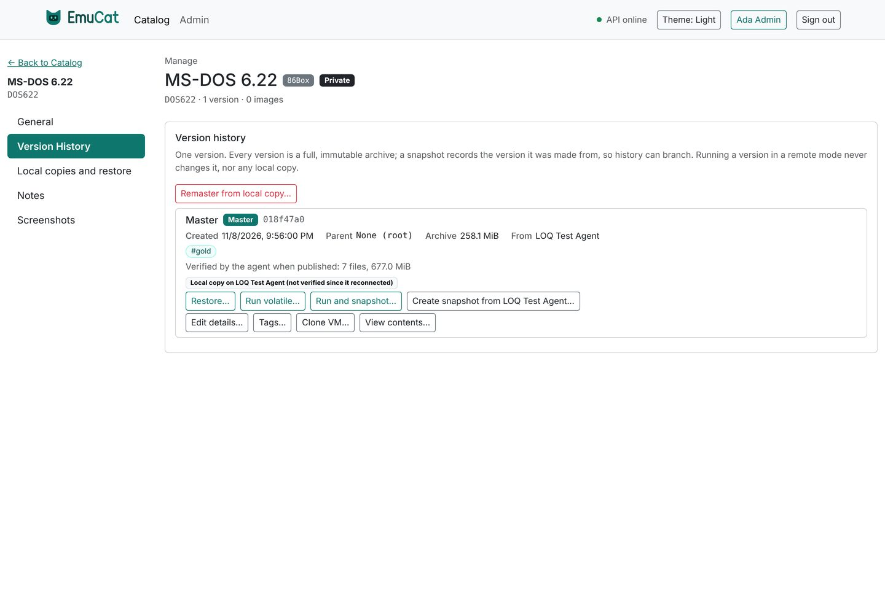
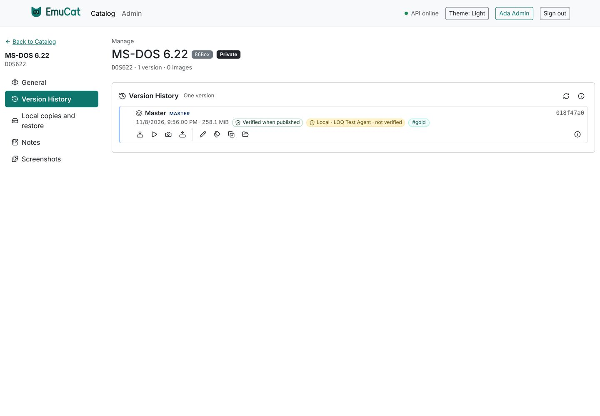
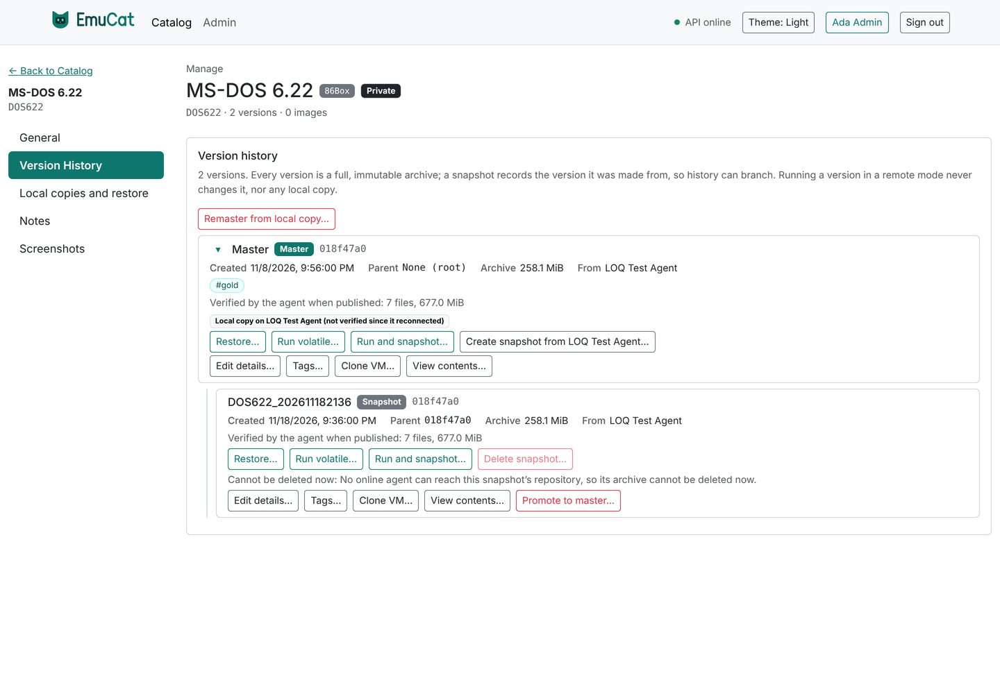
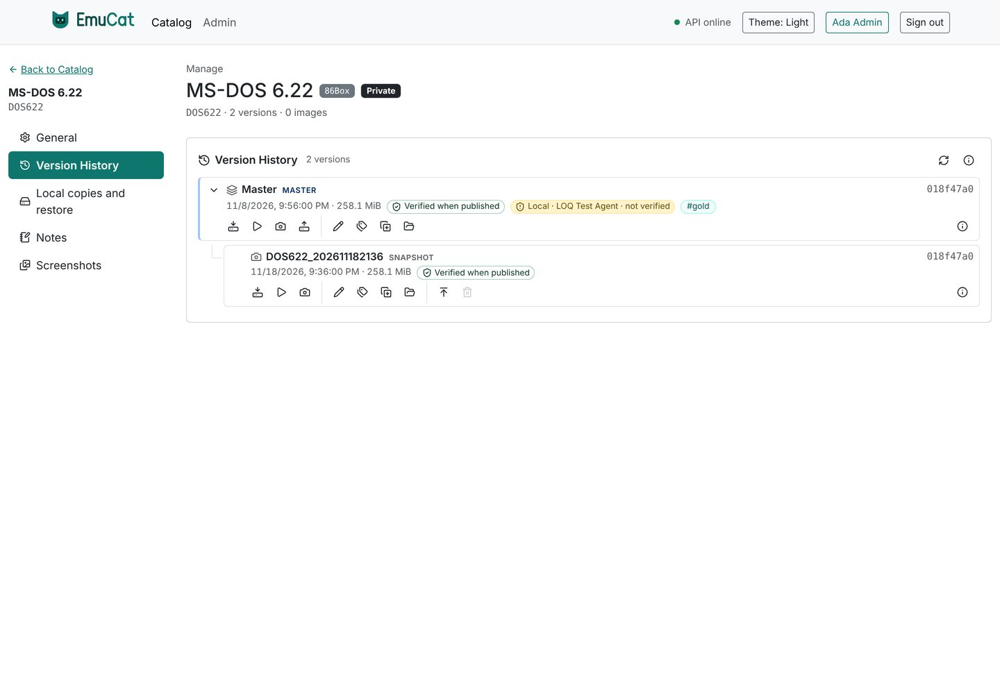
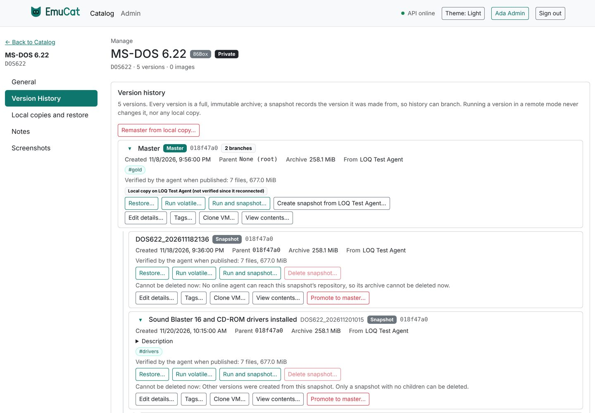
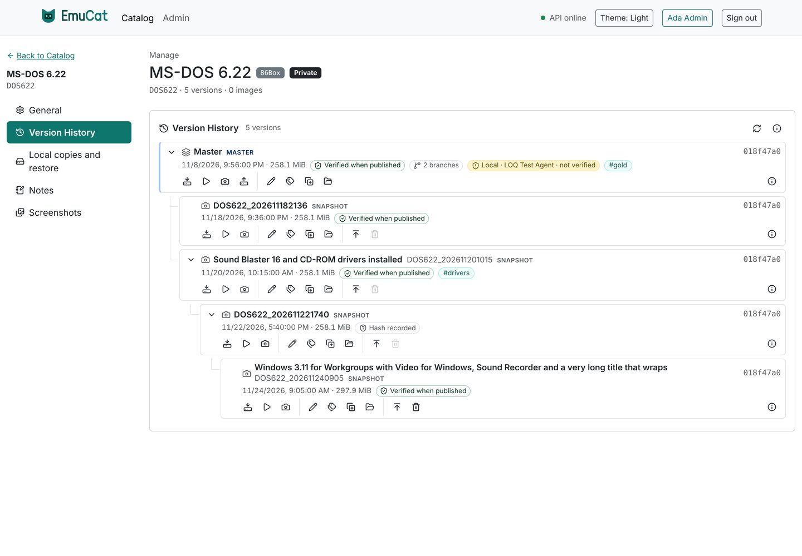
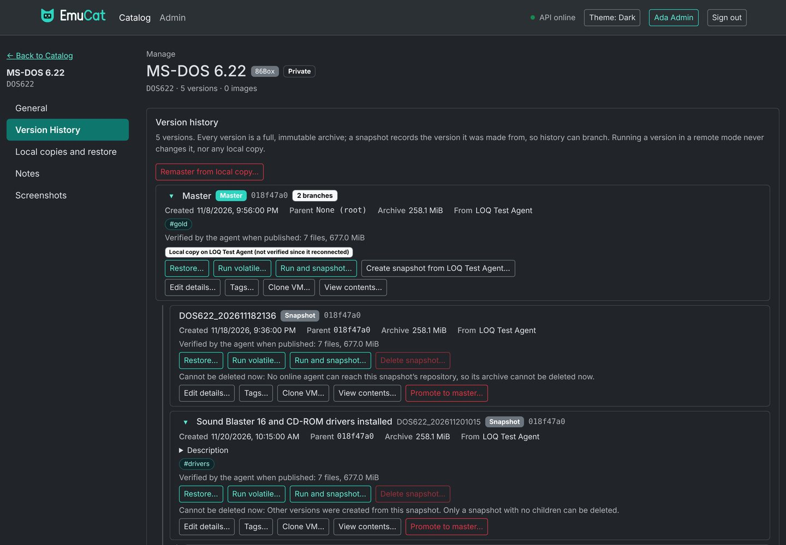
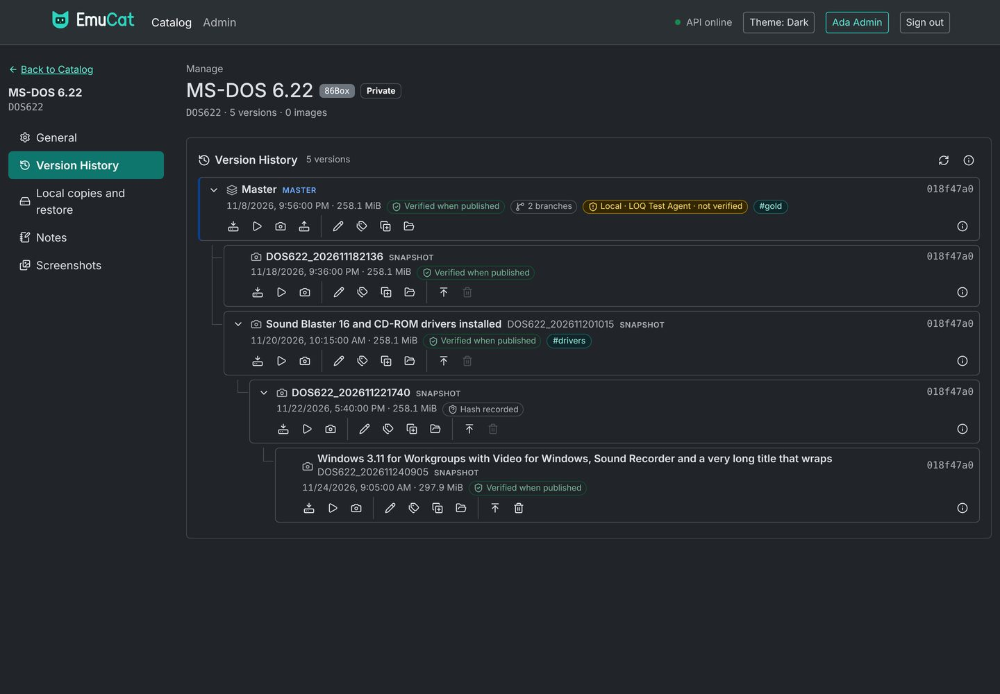
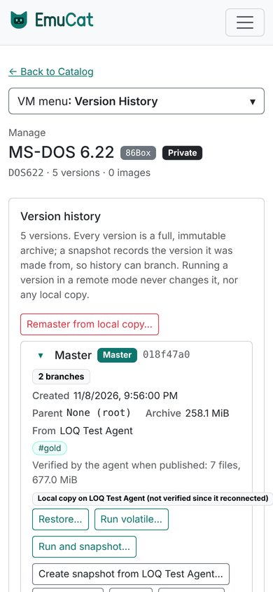
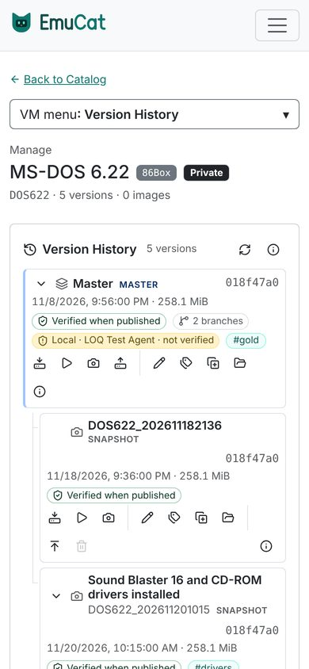

# EmuCat — Version History UI Refinement and Lucide Adoption: implementation report

Decision: [0059](../decisions/0059-version-history-icon-toolbars.md). Conventions: [ui-conventions.md](../ui-conventions.md).
Runbook: [runbook-0059-mars.md](../runbook-0059-mars.md).

## 1. Executive summary

Version History now draws each version as a compact, three-line card (identity; date, size, status chips and tags;
one Lucide icon toolbar) and gives everything else through a per-version **Info** panel. The page's explanation moved
into a page-level Info panel, and Remaster became an icon action in a one-line header. Every action is still offered
under exactly the conditions it was, and calls the same handler and dialog. Disabled actions now explain themselves
in a tooltip that is reachable by mouse, keyboard and screen reader, and in Info. The VM sidebar draws Lucide icons
beside its labels.

On the same 1440 × 1000 window a card shrank from 186–237 px to 89–107 px, and the visible versions of the test
history went from 3 to 5. On a 390 px phone a card shrank from 432–571 px to 176–282 px and the 1 px sideways scroll
is gone. Only `apps/web` and documentation changed; no API, contract, schema, agent or deployment change.

## 2. Starting branch and commit

`develop` at `79981c5` (docs: browser-local nested archives and the compact Archive Explorer, decision 0058), fetched
from `origin/develop` (the local checkout was at `a2e8988` and was fast-forwarded). The working tree was clean.

## 3. Preliminary frontend assessment

- `apps/web/src/components/Versions.tsx` holds the whole history: `VersionItem` (one card, recursive),
  `WorkspaceCard`, `VersionHistory` (data, polling, dialogs) and `VmVersionsSection` (the Manage page's card). The
  tree comes from `buildVersionTree` (contracts), children ordered by creation.
- Actions: Restore, Run volatile, Run and snapshot, Create snapshot from each local copy, Delete snapshot, Edit
  details, Tags, Clone VM, View contents, Promote to master, Remaster (page), Import into VirtualBox and Create
  snapshot (VirtualBox only), Retry deletion. For VirtualBox, the non-VirtualBox actions were rendered inside a
  `d-none` container (hidden from everyone).
- Permanent metadata: created, parent, archive size, From, Promoted, description (`<details>`), tags, verification
  sentence, local copies, deletion status, "Cannot be deleted now: …", VirtualBox paragraphs.
- Authorization: the page is administrator-only (route guard, decision 0039/0054); the component itself has no
  per-action role checks. The API checks every request.
- Shared primitives from 0058 in `components/ui/`: `IconButton`, `IconToggleButton`, `Toolbar`, `ToolbarGroup`,
  `ToolbarSeparator`, `ToolbarSpacer`, `InfoPopover`, `FileTypeIcon`. No status indicator and no disabled-reason
  support existed.
- Sidebar: `SidebarLayout` is shared by the Admin and VM sidebars; items come from `navigation.ts`.
- Tests that pin the page: `test/versions.test.tsx`, `test/virtualbox-management.test.tsx`, `test/notes-clone.test.tsx`,
  `test/navigation.test.tsx`, and the Windows-only API e2e (`execution.e2e.test.ts`, `restore.e2e.test.ts`), which
  select `.version-card`, the short identifier's `title`, `li[aria-labelledby="version-…"] > .version-card`, and names
  `/in Remote Snapshot$/` and `/^Delete /`. All of these are preserved.

## 4. Existing Lucide integration

`lucide-react` 1.69.0, imported icon by icon, introduced by decision 0058. All suggested icons exist except
`CameraPlus` (see §10). No other icon library was added.

## 5. Shared component reuse

Version History uses `IconButton`, `Toolbar`, `ToolbarGroup`, `ToolbarSeparator`, `ToolbarSpacer` and `InfoPopover`
unchanged in behaviour, and the existing `icon-*` and `info-*` styles. No page-specific copy of a primitive exists.

## 6. Shared component improvements

| Change                                                                       | Where                            | Effect on Archive Explorer                                                   |
| ---------------------------------------------------------------------------- | -------------------------------- | ---------------------------------------------------------------------------- |
| `disabledReason` (aria-disabled, description, inert click, two-line tooltip) | `IconButton`, `IconToggleButton` | None: it passes no reason                                                    |
| `danger` (danger colours on hover/focus only)                                | `IconButton`                     | None                                                                         |
| `tooltip`, `tooltipPlacement`                                                | `InfoPopover`                    | None: defaults unchanged                                                     |
| `StatusChip` (new)                                                           | `ui/StatusChip.tsx`              | Not used there                                                               |
| `icon-tooltip-wrap`, `icon-tooltip-title`, `[aria-disabled]` styles          | `styles.css`                     | Hover rules now also skip `aria-disabled`                                    |
| Info panels as a bottom sheet under 576 px                                   | `styles.css`                     | Its Info panels also become sheets on phones (inside the full-screen dialog) |
| `NavItem.icon` (optional)                                                    | `navigation.ts`, `SidebarLayout` | Admin sidebar unchanged                                                      |

The Archive Explorer browser suite (8 tests) and unit tests pass unchanged.

## 7. Version History header redesign

One line: History icon, **Version History** (the section's `h2`, still `vm-versions-heading`), "N versions", then a
toolbar with **Remaster from local copy** (RefreshCw, `danger`, disabled with "A remaster is already in progress."
while one exports, shown under the same condition as before: a drawable history and at least one local copy or linked
machine) and the page **Info** ("About the version history"). In the public VM page's admin tab, the same header is
drawn without the heading (the tab names it).

## 8. Master and Snapshot card redesign

Line 1: chevron (or a spacer), Layers (master) or Camera (snapshot), the title (an `h4`, still `id="version-<id>"`),
the label when there is a title, MASTER/SNAPSHOT, and the short identifier (`title` = full ID). Line 2: date and time
· archive size, status chips, tags. Line 3: the toolbar. A deletion in progress and its failure with **Retry now** stay
in view between them. The master card has a subtle left accent. Borders and padding are lighter; there is no nested
Bootstrap card.

## 9. Action toolbar design

Groups, in this order on every card: **Run and restore**, **Version management**, **Lifecycle**, then Info at the
right end. Groups are `role="group"` with labels, separated by vertical dividers; empty groups and their dividers are
not rendered (a version being deleted has only the first group and Info). The toolbar is a WAI-ARIA toolbar
(Left/Right/Home/End). On a wide window each card's toolbar is one row (asserted in the browser test); it wraps by
group on narrow windows.

## 10. Complete action-to-icon mapping

| Action                          | Icon                        | Tooltip                                        | Accessible name                                          |
| ------------------------------- | --------------------------- | ---------------------------------------------- | -------------------------------------------------------- |
| Remaster from local copy        | RefreshCw                   | Remaster from local copy                       | Remaster from local copy                                 |
| Restore                         | HardDriveDownload           | Restore version                                | Restore _name_                                           |
| Run volatile                    | Play                        | Run volatile                                   | Run _name_ in Remote Volatile                            |
| Run and snapshot                | Camera                      | Run and snapshot                               | Run _name_ in Remote Snapshot                            |
| Create snapshot from local copy | HardDriveUpload             | Create snapshot from the local copy on _agent_ | Create snapshot of _name_ from the local copy on _agent_ |
| Import into VirtualBox          | Import                      | Import into VirtualBox                         | Import _name_ into VirtualBox                            |
| Create snapshot (VirtualBox)    | Camera                      | Create snapshot of _machine_                   | Create snapshot of _machine_ from _name_                 |
| Edit details                    | Pencil                      | Edit details                                   | Edit details of _name_                                   |
| Manage tags                     | Tags                        | Manage tags                                    | Tags of _name_                                           |
| Clone VM                        | CopyPlus                    | Clone VM                                       | Clone _name_ into a new VM                               |
| View contents                   | FolderOpen                  | View contents                                  | View the archive contents of _name_                      |
| Promote to master               | ArrowUpToLine               | Promote to master                              | Promote _name_ to master                                 |
| Delete snapshot                 | Trash2                      | Delete snapshot                                | Delete _name_                                            |
| Version information             | Info                        | Version information                            | Information about _name_                                 |
| Page information                | Info                        | About the version history                      | About the version history                                |
| Collapse / Expand branch        | ChevronDown / ChevronRight  | Collapse branch / Expand branch                | Collapse _name_ / Expand _name_                          |
| Retry deletion                  | (text button, kept visible) | —                                              | Retry deleting _name_ now                                |

Substitution: `CameraPlus` does not exist in Lucide 1.69. **HardDriveUpload** is used: the local copy is archived and
uploaded as a new version, the mirror of Restore's HardDriveDownload. _name_ is the label, disambiguated by identity
when two labels repeat (unchanged logic). The agent name in the snapshot action comes from the version's own holders,
as before; nothing is hardcoded or inferred.

## 11. Tooltip implementation

The existing `IconButton` tooltip (an `aria-hidden` element shown on `:hover` and `:focus-visible`, never `title`).
New: a wrapped variant for explanations (max 18 rem), a bold title line, and right-aligned placement near the right
edge. Status chips show their full statement the same way on hover.

## 12. Disabled action explanations

`disabled` + `disabledReason` renders `aria-disabled="true"` instead of the native attribute, keeps the button in the
tab order, sets `aria-describedby` to the reason (written once in the tooltip), and replaces the click handler with
one that stops the event, so the caller's handler cannot run. The toolbar's arrow keys reach it. Native `disabled` is
kept where no reason is given. Reasons are only explanations of the conditions the buttons always checked (§3 table in
decision 0059). Every reason is also listed under **Unavailable now** in the version's Info, for touch users. Actions
hidden before (Delete on a master, Promote on a master, lifecycle on a version being deleted, VirtualBox-only actions)
stay hidden.

## 13. Version Info implementation

An `InfoPopover` (non-modal dialog named by the version's title) at the end of each toolbar, content rendered only
while open. Sections: Version, Description, Archive, (VirtualBox note), Verification, Copies on agents, Deletion,
Unavailable now. Identifiers and hashes are selectable in one click (`user-select: all`) and wrap. Escape or the
button closes it and returns the focus; a click outside closes it. On phones it is a bottom sheet.

## 14. Page Info implementation

"About the version history" holds the paragraph the page used to print, unchanged ("Every version is a full,
immutable archive; …"), and a note on what each version's Info contains. The count stays visible in the header.

## 15. Metadata preservation matrix

| Field (previous card)                                                                            | Now                                                    |
| ------------------------------------------------------------------------------------------------ | ------------------------------------------------------ |
| Title, label, Master/Snapshot, short ID                                                          | Card line 1                                            |
| Created                                                                                          | Card line 2 and Info                                   |
| Archive size                                                                                     | Card line 2 and Info                                   |
| Parent (short ID or "None (root)")                                                               | Info (with the parent's label added)                   |
| From (source agent)                                                                              | Info                                                   |
| Promoted badge and time                                                                          | "Promoted" chip (time in its tooltip) and Info         |
| "Being deleted" badge                                                                            | Chip, kept visible                                     |
| "_n_ branches" badge                                                                             | Chip and Info (Children)                               |
| Description                                                                                      | Info                                                   |
| Tags                                                                                             | Card line 2 and Info                                   |
| Verification sentence                                                                            | Chip (full sentence as tooltip/readable text) and Info |
| Local copies and working copies                                                                  | One chip per copy (full sentence) and Info             |
| Deletion status, failure, Retry now                                                              | Kept visible on the card; details also in Info         |
| "Cannot be deleted now: …"                                                                       | Delete's tooltip/description and Info                  |
| VirtualBox OVA paragraph, linked machine                                                         | Info; "Linked machine" chip                            |
| "No online agent can import into VirtualBox."                                                    | Import's reason and Info                               |
| "Power the machine off to create a snapshot."                                                    | Create snapshot's reason and Info                      |
| Count and explanatory paragraph                                                                  | Header count and page Info                             |
| (new) Kind, full ID, By, repository, archive SHA-256, files, uncompressed size, manifest SHA-256 | Info (already in the response)                         |

No new API request was added.

## 16. Status indicator mapping

See decision 0059 §4. Historical verification ("Verified when published") is never merged with a copy's state; each
copy has its own chip (verified: success; modified or not verified since reconnect: warning with ShieldAlert); a
working copy is neutral. The tree carries no agent connectivity, so no "agent offline" chip was invented.

## 17. Version tree visualization

Roles, levels, order and per-branch expansion are unchanged; no flattening. Children are indented 1 rem (0.5 rem on
phones) from a guide line under the parent's chevron, with an elbow to each child and the line ending at the last
child. The browser test checks the levels of a four-deep history and that collapsing one branch leaves the others.

## 18. VM Manage sidebar changes

Settings (General), History (Version History), HardDrive (Local copies and restore), NotebookPen (Notes), Images
(Screenshots), ArrowLeft (Back to Catalog). Labels, order, routes, active highlighting (`aria-current="page"`), the
collapsed narrow menu and the VM identity are unchanged. `ADMIN_NAV_ITEMS` has no icons (unit-tested).

## 19. Responsive behavior

Wide: one toolbar row per card. Narrow: the card head wraps the short ID below the name rather than breaking it,
the toolbar wraps by group, summary and toolbar lose their indentation, Info is a bottom sheet, and the page width
equals the window width (390 px, asserted). Touch targets are 44 px on coarse pointers (0058 rule). Browser zoom was
not measured in automation; it is checklist item A36.

## 20. Light and dark theme validation

Captured and asserted in the browser suite (`9-theme-light`, `9-theme-dark`, `8-branches-dark`): one border colour for
every resting toolbar button (no coloured borders), no `btn-outline-danger` in cards. All colours are Bootstrap
variables.

## 21. Accessibility

Unique accessible names for every icon; tooltips hidden from assistive technology; disabled reasons as descriptions;
`aria-expanded` on tree items and Info buttons; `aria-haspopup="dialog"` on actions that open dialogs; labelled
toolbars and groups; visible focus; focus restored after Info; status as icon plus words, never colour alone.

## 22. Functional regression validation

Each action keeps its handler. Verified by unit tests (jsdom, real App and router against a mock API):

| Action                          | Proven by                                                                                                              |
| ------------------------------- | ---------------------------------------------------------------------------------------------------------------------- |
| Restore                         | `opens the restore dialog on the chosen version` (POST body with that version)                                         |
| Run volatile / Run and snapshot | `chooses the version and mode in the run panel…`, `…Remote Volatile the same way…`, launcher test                      |
| Create snapshot from local copy | `confirms, names the version the copy came from as the parent…` (POST body), refusal test                              |
| Edit details                    | `edits only the title and description`, title limit test                                                               |
| Manage tags                     | `shows each version's own tags, and edits a snapshot's…`                                                               |
| Clone VM                        | `notes-clone.test.tsx` (`Clone Master into a new VM`)                                                                  |
| View contents                   | `opens Archive Explorer…` (unit) and browser test                                                                      |
| Promote                         | Four promotion tests (preview, conflicts, refusal, stale history)                                                      |
| Delete                          | Eligibility test (now also: unavailable clicks open nothing), confirmation test (POST body), deletion-in-progress test |
| Remaster                        | `needs the exact VM name typed, then follows each phase`, failed cleanup test                                          |
| Expand/collapse                 | `collapses and expands a branch` (unit and browser)                                                                    |
| VirtualBox import/snapshot      | `virtualbox-management.test.tsx` (import disabled while busy, now with its reason and an inert click)                  |

Version identity: every name includes the version's label (disambiguated by ID), and tests use those names. The
browser test records that hovering, opening Info and opening/cancelling Delete, Remaster and Restore send only `GET`.

## 23. Archive Explorer regression validation

`archive-explorer.browser.test.ts`: 8/8 passed (toolbars, File and Archive Info, previews, downloads with exact bytes,
nested archives, no off-origin request, no console error, responsiveness). Unit: `archive-explorer.test.tsx` and
`archive-nested.test.tsx` passed. The new Version History browser test also opens it from View contents.

## 24. Automated test results

Run in Claude Code Web (Linux, Node 22.23.5, pnpm 12.10.1):

| Command                                                 | Result                                                                               |
| ------------------------------------------------------- | ------------------------------------------------------------------------------------ |
| `pnpm --filter @emucat/web test`                        | **Passed**: 28 files, 614 tests (602 before; +12 primitives)                         |
| `pnpm --filter @emucat/contracts test`                  | **Passed**: 448                                                                      |
| `pnpm --filter @emucat/deployer test`                   | **Passed**: 51                                                                       |
| `pnpm -r check` (tsc for contracts, deployer, api, web) | **Passed**                                                                           |
| `npx eslint .`                                          | **Passed**                                                                           |
| `npx prettier --check .`                                | **Passed**                                                                           |
| API tests (`apps/api`, need MariaDB)                    | **Not executed**: no Docker daemon in this environment. Not affected (no API change) |
| Agent tests (`cargo test`), `pnpm test:sftp`            | **Not executed**: agent unchanged                                                    |
| `pnpm test:e2e` (Windows only)                          | **Not executed**: needs Windows, the agent, MariaDB and Docker                       |
| `pnpm test:compose`, `pnpm test:deploy`                 | **Not executed**: no Docker daemon                                                   |
| `cargo clippy`/`cargo fmt` (part of `pnpm lint`)        | **Not executed**: agent unchanged                                                    |

## 25. E2E results

`EMUCAT_BROWSER_PATH=/opt/pw-browsers/chromium pnpm --filter @emucat/web test:browser`: **19/19 passed** (Archive
Explorer 8, Version History 11). The Windows API e2e suite was not run; its Version History selectors
(`.version-card`, the short ID's `title`, `li[aria-labelledby] > .version-card`, `/in Remote Snapshot$/`,
`/^Delete /`) are all preserved.

To run locally on Windows:

```powershell
pnpm install
pnpm --filter @emucat/web test
pnpm --filter @emucat/web test:browser
pnpm db:up
pnpm test
pnpm test:e2e
```

## 26. Production build results

`pnpm --filter @emucat/web build`: **passed** (Vite 8, 2,419 modules). The existing "chunk larger than 500 kB"
warning is unchanged by this work.

## 27. Before-and-after screenshots

Same synthetic history (`e2e/version-history-fixtures.ts`), same viewports, Chromium. Fixture IDs share their first
eight characters, so every short ID reads `018f47a0`.

| Scenario                     | Before                                                       | After                                                       |
| ---------------------------- | ------------------------------------------------------------ | ----------------------------------------------------------- |
| 1. Master without snapshots  |     |     |
| 2. Master with one snapshot  |    |    |
| 3. Branches (light)          |  |  |
| 8. Dark theme                |   |   |
| 10. Narrow viewport (390 px) |         |         |

After only: 4/5 stale local copy and unavailable Delete are in scenario 3 (amber chip on the master; faded Trash on
snapshots with children or an unreachable repository); 6 [Info open](assets/version-history-0059/after-6-version-info.jpg);
7 [disabled tooltip](assets/version-history-0059/after-7-disabled-action-tooltip.jpg);
9 [light](assets/version-history-0059/after-9-theme-light.jpg) and [dark](assets/version-history-0059/after-9-theme-dark.jpg);
[narrow Info sheet](assets/version-history-0059/after-10-narrow-info.jpg). Raw numbers:
`assets/version-history-0059/{before,after}-measurements.json`.

## 28. Visual density comparison

| Measure                             | Before                                                       | After       |
| ----------------------------------- | ------------------------------------------------------------ | ----------- |
| Card height, 1440 × 1000            | 186–237 px                                                   | 89–107 px   |
| Versions fully visible, 1440 × 1000 | 3 of 5                                                       | 5 of 5      |
| Tree starts at (page y)             | 339 px                                                       | 255 px      |
| Card height, 390 × 844              | 432–571 px                                                   | 176–282 px  |
| Versions fully visible, 390 × 844   | 0                                                            | 2           |
| Page width at 390 px                | 391 px (sideways scroll)                                     | 390 px      |
| Permanent metadata rows per card    | 3–5 (facts, description, tags, verification, copies, reason) | 1 (summary) |
| Action rows per card (wide)         | 2–3                                                          | 1           |

## 29. Important changed files

- `apps/web/src/components/Versions.tsx`: cards, toolbars, Info, header.
- `apps/web/src/components/ui/IconButton.tsx`, `ui/Popover.tsx`, `ui/StatusChip.tsx` (new).
- `apps/web/src/navigation.ts`, `components/SidebarLayout.tsx`, `pages/admin/vm/VmManageLayout.tsx`: sidebar icons.
- `apps/web/src/styles.css`: version tree, chips, wrapped tooltips, aria-disabled, danger, phone sheet, sidebar.
- Tests: `test/versions.test.tsx`, `test/virtualbox-management.test.tsx`, `test/navigation.test.tsx`,
  `test/ui-primitives.test.tsx` (new), `e2e/version-history.browser.test.ts` and `e2e/version-history-fixtures.ts`
  (new), `e2e/server.ts` (SPA fallback option).
- `.gitignore`, `.prettierignore`, `eslint.config.js`: ignore `apps/web/e2e/dist-app`.
- Docs: decision 0059, `docs/ui-conventions.md`, `docs/testing.md`, `docs/runbook-0059-mars.md`, this report.

## 30. Shared UI conventions documentation

[docs/ui-conventions.md](../ui-conventions.md): Lucide and individual imports, sizes, the four rules (operational
actions, navigation, metadata, status), names and tooltips, groups, keyboard, dialogs, destructive styling,
unavailable actions and authorization, Info panels, status chips, responsive behaviour, themes and tests.

## 31. Known limitations

- Hover tooltips are not available on touch screens; touch users read reasons and statements in Info.
- Browser zoom was not measured automatically (checklist A36).
- The Windows API e2e suite, API tests, Compose and deploy tests were not run here (no Windows, no Docker daemon).
- Tests in other files (`restore.test.tsx`, Windows e2e) that use the name "Restore…" target the Local copies page,
  which is unchanged.
- A local `apps/web/e2e/dist-app` is not excluded by `.dockerignore`; it never exists in a release (built from
  `git archive`), and the final web image copies only `apps/web/dist`. `.dockerignore` was left unchanged to keep
  deployment files untouched.
- No application defect was found that needed separate reporting.

## 32. Infrastructure and configuration impact

None: no API runtime, endpoint, contract, migration, environment variable, Compose, reverse-proxy, deployment
tooling, or Windows agent change. `git diff --stat 79981c5 HEAD -- deploy apps/api apps/deployer agent packages` is
empty.

## 33. Exact Mars deployment runbook

[docs/runbook-0059-mars.md](../runbook-0059-mars.md). In short, on MARS:

```bash
sudo /opt/emucat/tooling/bin/emucatctl status
```

```bash
sudo /opt/emucat/tooling/bin/emucatctl check-update
```

```bash
sudo /opt/emucat/tooling/bin/emucatctl check
```

```bash
sudo -u emucat-deploy git --git-dir=/opt/emucat/repo.git show refs/remotes/origin/develop:deploy/bin/emucatctl | sudo diff -q /opt/emucat/tooling/bin/emucatctl - && echo "tooling is current"
```

```bash
sudo /opt/emucat/tooling/bin/emucatctl backup
```

```bash
sudo /opt/emucat/tooling/bin/emucatctl update
```

No repository checkout, tooling refresh, `emucatctl install`, configuration change, migration or agent update is
required (verified against the release's tooling and `git diff`).

## 34. Functional acceptance checklist

Runbook §5: 40 non-destructive checks (A1–A40) and 5 operations on a disposable VM (B1–B5).

## 35. Rollback instructions

```bash
sudo /opt/emucat/tooling/bin/emucatctl rollback-app --to <previous>
```

No migration, so no database restore; reload browser tabs.

## 36. Git commits and push confirmation

On `develop`, author and committer `david <davidfriscia@gmail.com>`:

- `ec3ddbf` feat(web): compact Version History with Lucide icon toolbars and metadata on demand (decision 0059)
- docs: Version History refinement (decision 0059), UI conventions, report and MARS runbook (this commit)

Both pushed to `origin/develop`. `main` was not touched; nothing was deployed to MARS or MOON.

## Mandatory questions

| Question                                                               | Answer                                                                                                                       |
| ---------------------------------------------------------------------- | ---------------------------------------------------------------------------------------------------------------------------- |
| Were the existing Lucide components reused?                            | Yes: IconButton, Toolbar, ToolbarGroup, ToolbarSeparator, ToolbarSpacer, InfoPopover                                         |
| Were any new reusable UI components introduced?                        | One: `StatusChip`. Plus props `disabledReason`, `danger`, InfoPopover `tooltip`, `NavItem.icon`                              |
| Are all previous Version History actions still available?              | Yes                                                                                                                          |
| Were any actions removed?                                              | No. The VirtualBox page's hidden (`d-none`) non-VirtualBox buttons are no longer rendered; they were never visible or usable |
| Were any action eligibility conditions changed?                        | No                                                                                                                           |
| Were any operation handlers changed?                                   | No                                                                                                                           |
| Are all previously available metadata fields preserved?                | Yes (§15)                                                                                                                    |
| Is detailed metadata accessible through Info?                          | Yes                                                                                                                          |
| Are disabled action reasons still discoverable?                        | Yes: tooltip, accessible description, and Info › Unavailable now                                                             |
| Are they accessible through keyboard navigation?                       | Yes: the buttons stay focusable (aria-disabled) and show the reason on focus                                                 |
| Are unauthorized actions still protected?                              | Yes: nothing hidden is shown; the page stays admin-only; the API checks every request                                        |
| Are destructive confirmation flows unchanged?                          | Yes                                                                                                                          |
| Is historical verification distinguished from local copy verification? | Yes: separate chips, and Info says publication-time verification is not current                                              |
| Are important warnings still visible?                                  | Yes: deletion in progress and failures, inconsistent history, stale copies (amber chip)                                      |
| Is the existing version graph preserved?                               | Yes                                                                                                                          |
| Is the version tree more compact?                                      | Yes (§28)                                                                                                                    |
| Does the Manage sidebar use Lucide icons alongside text labels?        | Yes                                                                                                                          |
| Does Archive Explorer continue to work correctly?                      | Yes (§23)                                                                                                                    |
| Were any API runtime files modified?                                   | No                                                                                                                           |
| Were any API endpoints or contracts modified?                          | No                                                                                                                           |
| Was the Windows agent modified?                                        | No                                                                                                                           |
| Are database migrations required?                                      | No                                                                                                                           |
| Are environment changes required?                                      | No                                                                                                                           |
| Are reverse-proxy changes required?                                    | No                                                                                                                           |
| Is a deployment tooling refresh required?                              | No (MARS must already run 0055+ tooling, which the runbook checks)                                                           |
| What exact commands must the user execute on Mars?                     | §33 / runbook §2–4: status, check-update, check, tooling diff, backup, update, then the §4 checks                            |
| Which tests could not be executed?                                     | API tests, agent tests, `test:sftp`, `test:e2e`, `test:compose`, `test:deploy`, cargo lint (§24)                             |
| Was main left unchanged?                                               | Yes                                                                                                                          |
| Was any deployment performed?                                          | No                                                                                                                           |
